# Hearth: A Home for Your Local AI

*Chat with local models, test how they work, and follow coding agents from one self-hosted workspace.*

Hearth brings your local AI tools together in one browser app. Chat with models
running on your own hardware, compare how they handle coding tasks, and follow
OpenCode agents as they work. Conversations, settings, and agent projects are kept
in your own PostgreSQL-backed installation.

Choose from supported CPU, GPU, and AMD Ryzen AI NPU backends. Hearth also includes
an OpenAI-compatible gateway for coding clients, model search and downloads, web
research, voice tools, and cross-chat memory. Add Tailscale when you want private
remote access to your home setup.

[Get started](#first-time-setup) · [Explore features](#what-you-can-do-with-hearth) ·
[Test models](#local-llm-testing-and-tool-calling-evaluation) ·
[Use coding agents](#agentic-ai-and-local-coding-agents) ·
[Personal AI](#a-personal-ai-assistant-on-your-own-hardware) ·
[Search and download models](#search-download-and-manage-local-ai-models) ·
[Secure coding gateway](#secure-model-gateway-for-opencode-continue-and-vs-code) ·
[Tailscale remote access](#tailscale-remote-access-for-chat-and-coding-models) ·
[All features](#current-feature-directory)

> Hearth uses PostgreSQL 18 through Docker Compose. The first-time installer
> starts a clean database, loads the application DDL, creates the initial admin,
> and configures the app to start automatically after reboot. See the
> [installation guide](deploy/FIRST_TIME_INSTALL.md) for setup details.

A small Flask web UI for chatting with local models, with sidebar controls to load/unload
models and switch which loaded model you're chatting with. Hearth started as an LM Studio
front-end and now drives **five** local inference backends behind one chat UI — [LM Studio](https://lmstudio.ai), [Lemonade / Ryzen AI NPU](https://github.com/lemonade-sdk/lemonade),
[vLLM](https://github.com/vllm-project/vllm), [KoboldCPP](https://github.com/LostRuins/koboldcpp),
and [FastFlowLM](https://github.com/FastFlowLM/FastFlowLM) (the Ryzen AI NPU runtime run
standalone) — plus ComfyUI for image generation. Each backend is exposed to LAN coding tools
(Continue, OpenCode) over its own authenticated Caddy reverse-proxy port (see **Help**), and
every one has the same Search / Download / Load / Unload / Delete lifecycle from the Models and
Downloads pages. Beyond chat it also does cross-chat memory (RAG), auto-detected web search,
voice in/out, a performance-metrics board, and an in-chat practice-test/quiz platform —
all documented in their own sections below.

## What you can do with Hearth

| Use case | Included capabilities |
|---|---|
| Local AI chat | Streamed answer and reasoning updates during generation, saved conversations, document attachments (PDF, Word, PowerPoint, Excel, TXT, and CSV) for analysis and follow-up questions, copy individual responses or an entire conversation, model switching, and supported reasoning displays |
| Model management | Search, download, upload local GGUF files to Lemonade, load, unload, and delete models through supported backends; set per-model thinking for Lemonade models and see supported context limits on the Models page |
| LLM evaluation | Compatibility and tool-calling tests, a scored reasoning benchmark, security behavior probes, saved reports, and per-question results |
| Agentic coding | OpenCode project tasks with a configurable per-turn step limit, progress monitoring, user-input handling, and configured verification commands |
| Personal AI memory | Cross-chat memory retrieval with local embeddings and stored conversation history |
| Web research | Web search and page retrieval, optional Chromium scraping, Playwright browser actions, and searchable AI browser history |
| Voice assistant | Microphone input, speech transcription, and spoken responses with configured voice components |
| Creative tools | Image and video generation through separately configured ComfyUI workflows |
| Learning | In-chat practice tests and quizzes |
| Performance monitoring | Request metrics, token usage, generation speed, and a dedicated live developer logs page |

## Hearth in action

Watch the [25-second Hearth feature demo with sound](docs/screenshots/hearth-feature-demo.mp4).
The animated preview below is silent; open the video for the original music and sound effects.

[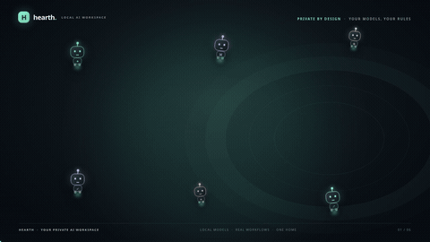](docs/screenshots/hearth-feature-demo.mp4)

Screenshots show the chat workspace, local model controls, model evaluation, the
agent task editor, performance metrics, live request logs, and AI browser history.
Chat and agent setup use fictional demo text. Metrics, live-log, and browser-history
screenshots show their empty states.

| Sign in to Hearth | Agents moving between workflow steps |
|---|---|
| 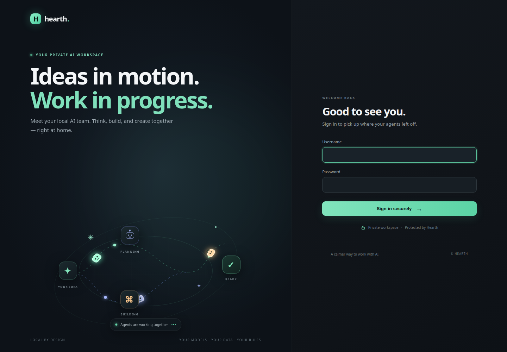 | 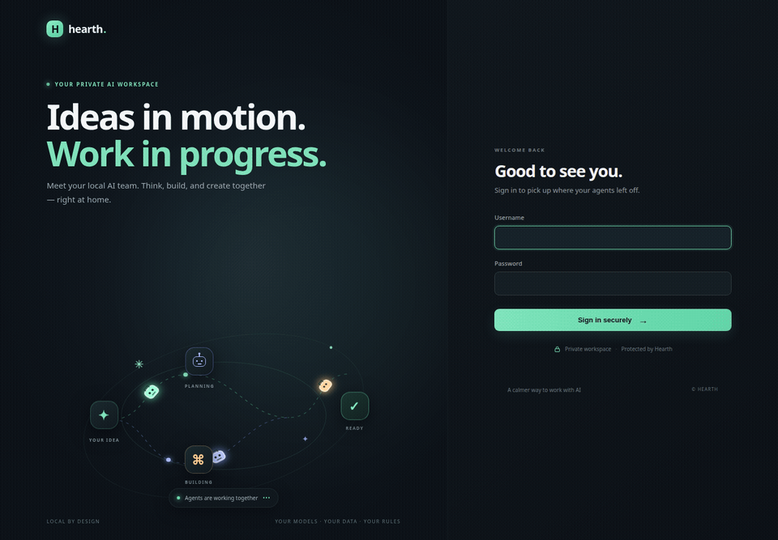 |

| Find and download a model |
|---|
| 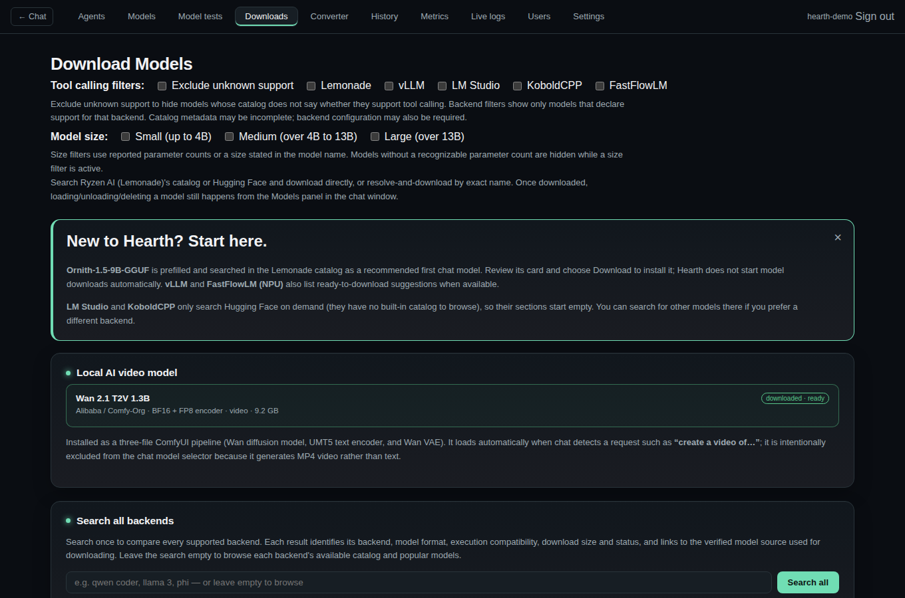 |

| Chat with a local model | Manage local models |
|---|---|
| 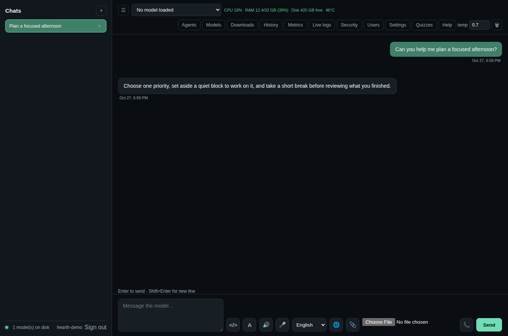 | 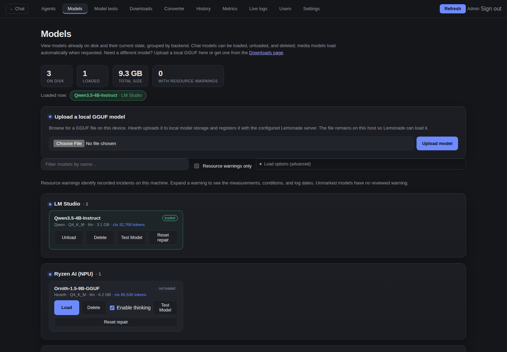 |

| Evaluate model behavior | Set up an agent task |
|---|---|
| 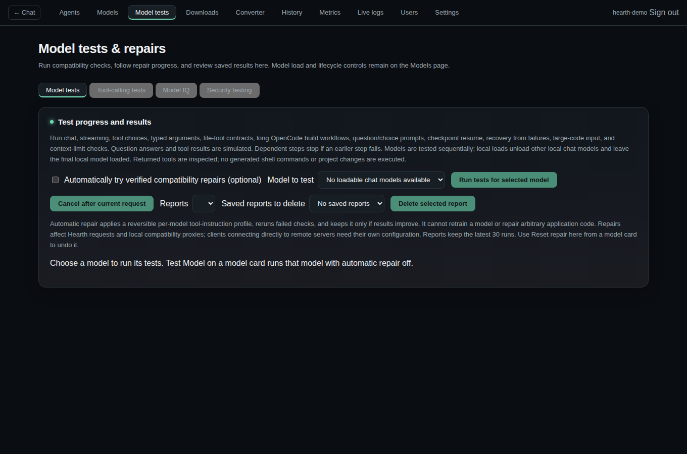 | 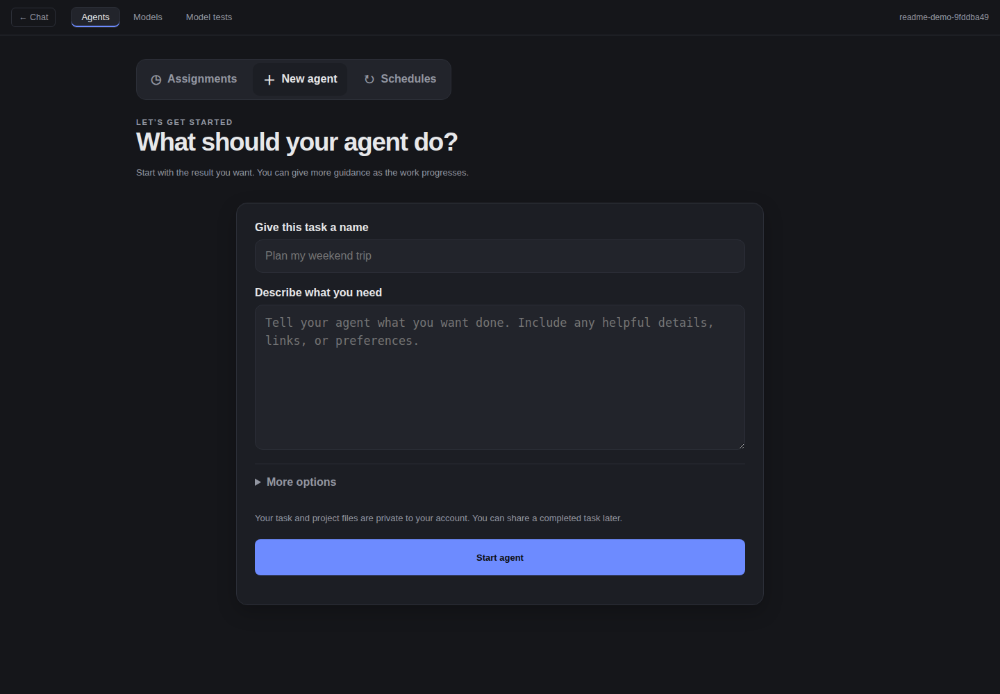 |

| Review performance metrics | Inspect live request logs |
|---|---|
| 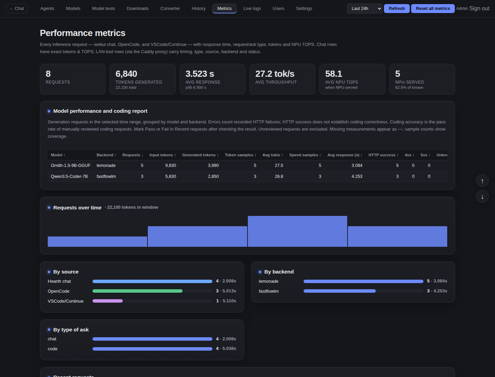 | 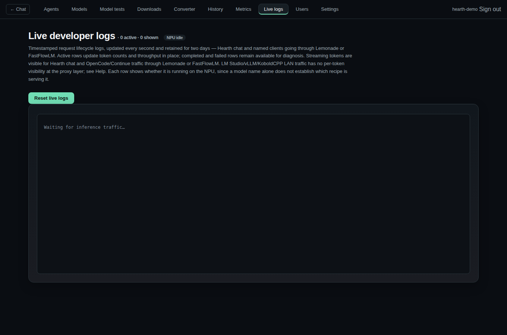 |

| Review AI browser history |
|---|
| 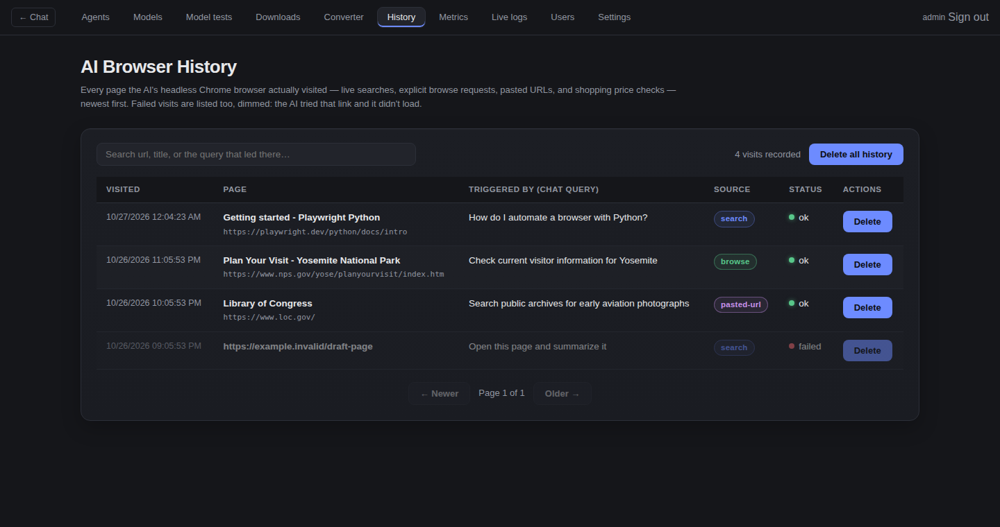 |

## Search, download, and manage local AI models

Hearth combines **local model discovery, Hugging Face model search, model downloads,
and model management** in one browser interface. Open **Downloads** as an
administrator to find models, then use **Models** to load and evaluate them.

1. Use **Search all backends** to search LM Studio, Lemonade, vLLM, KoboldCPP,
   and FastFlowLM together, or search a single backend. Leave the search field
   empty to browse each backend's available catalog or popular Hugging Face models.
2. Compare result cards by backend, model format, execution compatibility, download
   size, task type, update date, popularity, download status, and source link. Each
   card labels tool-calling support as **yes**, **no**, or **unknown**, based on
   catalog metadata.
3. Use **Exclude unknown support** to hide models whose catalog does not say
   whether they support tool calling; models marked **no** remain visible. The
   independent **Tool calling filters** restrict selected backends to models whose
   catalog metadata explicitly declares support. A positive label does not guarantee
   compatibility with every tool or runtime, so use **Model tests** before relying on it.
4. Filter by parameter count with **Small** (up to 4B), **Medium** (over 4B through
   13B), or **Large** (over 13B). These filters use reported parameter counts or
   recognizable sizes in model names/descriptions; models without a detectable
   count are hidden while a size filter is active. Clear the size checkboxes to
   show all sizes again.
5. **Downloads** opens with the recommended Lemonade `Ornith-1.5-9B-GGUF` search
   selected. Review the result and choose Download; Hearth does not download model
   weights automatically. Follow progress and logs, inspect active downloads, or
   cancel a download.
6. To use a model file already on your device, choose **Upload a local GGUF model**
   on Models, browse to a `.gguf` file, and upload it. Hearth validates the GGUF
   header, stores the file under `data/local-models`, and registers it with the
   configured Lemonade server. That server must run on the Hearth host or be able to
   read the stored file path. The upload transfers the full model file to Hearth;
   ensure the host has enough disk space. The model then appears in **Models**.
7. Open **Models** to load, unload, or delete installed models. Select a loaded
   chat model in the conversation model picker. Deleting a model is blocked while
   active agent work or a model test run uses that same model; other offline models
   remain available for deletion. For LM Studio models, Hearth resolves catalog aliases
   through LM Studio's installed model index and verifies the model entry under its models
   directory before removing its folder. Model files may link into the Hugging Face cache;
   Hearth removes those links without traversing their targets. A failed load is shown on
   its model card and refreshed across open Models pages every five seconds; the current
   error clears after Hearth confirms a successful load. Reviewed model warnings stay
   dismissed after a successful load and return if a later load attempt fails.
8. Check the maximum context-token label shown on a **Downloads** result when
   metadata reports it. In **Models**, check the context limit shown on each label when choosing
   how much chat history to send. The displayed limit is the model/backend
   capability Hearth knows about; runtime settings can impose a lower active
   context size.
9. On a Lemonade model card, use **Enable thinking** to choose whether Hearth chat requests
   include that model's reasoning phase. The toggle is saved per model and overrides the
   Lemonade default in Settings; Hearth passes it through both Lemonade's request control and
   the chat-template option. Models whose runtime does not support thinking controls may ignore it.
10. Run **Model tests** before using a model for coding or tool-driven workflows.

| Backend | Model discovery and download sources | Execution |
|---|---|---|
| LM Studio | Hugging Face GGUF search; direct model name or repository URL | CPU/GPU as supported by LM Studio |
| Lemonade | Curated catalog and Hugging Face search, including GGUF models | CPU/GPU/NPU according to model recipe and hardware |
| vLLM | Catalog and Hugging Face causal language model repositories | Depends on the installed vLLM runtime; the documented host uses CPU |
| KoboldCPP | Hugging Face GGUF search and downloads | CPU/GPU according to the installed build |
| FastFlowLM | FastFlowLM NPU catalog and exact model tags | Supported AMD Ryzen AI NPU hardware |

A model appearing in search does not establish that it fits your hardware or
supports every feature. Hearth includes resource checks and load feedback; runtime
compatibility, available memory, context size, and model capabilities still apply.
Embedding, speech, image, and video models have separate purposes from chat models.

On **Models**, each model label includes its maximum supported context-token count
when the backend reports or Hearth can determine it. This helps compare model
limits before loading or chatting; the actual usable context may be lower when a
runtime or backend setting applies a smaller value.

### Model picks for faster replies

For a smaller desktop that can fit a quantized 9B model, my recommended
all-around pick is [Ornith-1.5-9B-GGUF](https://huggingface.co/ornith-ai/Ornith-1.5-9B-GGUF),
starting with its **Q4_K_M** quantization. It is a dense 9B model distributed in
GGUF for local inference, giving a stronger quality and capability balance than
the tiny models below while remaining practical on a desktop. Actual memory use
and speed depend on quantization, context length, and how much work can run on the
GPU.

For quick everyday chat on a supported Ryzen AI NPU, start with FastFlowLM's
`qwen3:0.6b`. On the documented host it produced about **57 generated tokens per
second** in a live chat request. Its small size helps response speed, while larger
models are generally a better fit for complex reasoning and coding tasks.

For a compact model that can also handle tool calling, **Qwen3.8-2B-Distill** is
another fast option. It has worked for tool-driven tasks on this setup and is a good
pick when a larger coding model feels slow.

For coding on that host, the measured KoboldCPP setup with Qwen3 8B and Qwen3
0.6B speculative decoding produced about **5.1 tokens per second**, compared with
**4.3 tokens per second** without speculative decoding. Long coding histories can
still make prompt processing slow; use a GPU-backed model that fits your hardware
and keep context focused when turnaround matters. These are measurements from one
machine and model configuration, not speed guarantees. Compare your own backend and
model in **Metrics**, since hardware, quantization, context length, and workload all
affect response time.

## Test and compare models before coding

The Model tests page groups four suites into tabs: compatibility tests, tool-calling
tests, a 12-question reasoning benchmark, and 10 model security behavior probes.
The reasoning benchmark presents each original question separately, checks it against
a fixed answer key, and reports points correct. It is not a human IQ measurement:
human IQ scores depend on standardized, normed psychological assessments and must not
be inferred from this model benchmark. The security suite probes response behavior
for injection, disclosure, unsafe requests, privacy, and unauthorized actions; it
does not scan the host or prove the model or deployment secure. Tool calls are never
executed by these suites. Results and individual check details are saved with the
existing model-test reports.

Open **Model tests** and choose an installed chat model to run its test suite by
itself. **Test Model** on a model card runs the model from that card. Follow the
current check and elapsed time, cancel
after the current request, reopen recent runs, download JSON reports, or delete
older saved reports from the separate report-management selector, including while
another model is being tested. The active report cannot be deleted. Automatic
compatibility repair is off by default, including for model-card launches. The
Model tests dropdown selects Ornith by default when available. Select automatic
repair on the Model tests page to opt in.
The Lemonade gateway converts a named-function choice to a required call with only
that function offered. When the request also provides exact arguments, Hearth
returns that named call even if the model replies with prose or another function.
For FastFlowLM's `minicpm-v-4.7:1b`, Hearth adds a model-specific tool-use reminder,
honors exact named calls, and suppresses calls on clear direct-answer turns. These
adjustments are limited to that model; by default it can perform up to six tool rounds for
multi-step browser tasks, then Hearth requests a text-only summary of the results.
Other FastFlowLM models keep their existing path.
For Hearth chat across backends, administrators can set the maximum tool-call retries
(rounds) per response in Settings (1–64, default 6); the limit applies to the next chat request.
When browser tools are available, Hearth adds their usage guidance to the leading system
message and combines system instructions into one leading message for chat templates that
require system instructions first.

The local LLM test suite covers chat and streaming, tool selection, typed JSON
arguments, parallel tool calls, file reads and edits, exact file content, error
recovery, large inputs, and context overflow. OpenCode scenarios also exercise
planning, multi-file workflows, questions and answers, permission decisions, and
continuation after context compaction. Reports distinguish failed checks from
steps blocked by an earlier failure. Automatic repair compares only checks that
actually ran; blocked dependent steps do not inflate failure or repair counts.
Final test summaries may spell out the verified count or emphasize it with
Markdown. The OpenCode scenarios check multi-file reads across consecutive tool turns, while
the core contract suite separately measures parallel tool calls.
Hearth converts supported model-native `<tool_call>` markup from Lemonade into
structured calls only when the function is present in the request's tool schema.
An instruction not to repeat a question does not suppress a later explicit tool action
in the same turn.

Use these results to compare model/backend configurations for your coding workflow.
The tests supply simulated tool results; real project execution takes place in
**Agents** or your connected coding client. See
[the evaluation overview](#local-llm-testing-and-tool-calling-evaluation) and
[saved test evidence](reports/saved-failure-review-2026-10-19.md).

## Streaming chat and copying responses

Chat document attachments are sent as part of the same saved chat turn as the
user's question. The paperclip accepts up to five PDF, DOCX, PPTX, XLSX, TXT, or
CSV files, 15 MB each; Hearth extracts their text before publishing the turn to
the selected agent/model. If an attachment fails, Hearth reports the extraction
error instead of silently sending an incomplete turn. Scanned PDFs need OCR
before attachment.

Hearth streams generated response text into the conversation as the backend sends
it, including supported reasoning/thinking updates. The assistant message grows
during generation so you can see progress before the model finishes. Streaming
depends on the selected backend and model exposing incremental output; some models
may send reasoning separately or not expose it at all.

Use the small **Copy** icon on an assistant response to copy its text to the
clipboard. The control appears with the response after it is available.

## Secure model gateway for OpenCode, Continue, and VS Code

Use local models from a terminal coding agent or an editor on another machine.
Hearth integrates with **OpenCode** and **Continue for VS Code** through
backend-specific **OpenAI-compatible API endpoints**, with **Caddy HTTPS reverse
proxies and bearer-token authentication** when the gateway is configured.

1. Configure the desired inference backend and load a compatible coding model in
   **Models**. Check its tool-test results and loaded context size.
2. Configure the host's Caddy gateway and backend proxy services. These are separate
   from the basic first-time app/database installation.
3. Open Hearth's **Help** panel for the detected gateway addresses, CA certificate
   trust instructions, and generated Continue YAML or OpenCode JSON configuration.
   Configurations use the current model inventory and backend settings.
4. Trust the gateway's local CA on the client when using Caddy's internal
   certificates, and apply any client-specific CA settings shown in Help.
5. Copy the configuration for your **LAN** or configured **Tailscale** address into
   your coding client, then select the corresponding model.

Use the addresses displayed by your installation: backend ports can differ, and
hosted services may already occupy a port. The gateway requires its configured
bearer token. Administrators can retrieve or regenerate per-user gateway tokens
from **Users** and apply the supplied Caddy configuration. Token changes require
updating and reloading Caddy to take effect at the gateway.

Hearth's compatibility layers handle supported tool-call formats and request
policies. Generated coding-client configurations account for model context limits;
Settings also exposes context and OpenCode compaction controls. For compatible
coding requests, Hearth preserves explicit reasoning preferences, applies its Qwen
repetition control, and shortens oversized historical tool output while retaining
its beginning and end. It honors a clear text-only completion instruction without
disabling tools when the same turn requests concrete work. These policies help avoid
unnecessary tool calls and repeated long prefill. Request attribution helps
distinguish browser chat, OpenCode, and Continue traffic in **Metrics**.
Continue can additionally use a configured embedding model for codebase indexing.

See [codebase RAG](#codebase-retrieval-for-coding-clients),
[client attribution](#metrics-and-diagnostics), and
[Tailscale access](#tailscale-remote-access-for-chat-and-coding-models).

## Tailscale remote access for chat and coding models

Hearth includes **Tailscale access inside the app**: detected connection details,
clickable remote browser links, backend connection tests, and ready-to-copy
OpenCode and Continue configurations. Use the app to find the correct connection
for your phone, laptop, or remote coding workstation.

### Find your remote access links in Hearth

1. Open **Help** from the chat interface and expand **Connect over Tailscale**.
2. When the host has a detected Tailscale Serve route, this section shows a
   **Chat** link using the host's trusted HTTPS DNS address, including its configured
   port. Connect your other device to the same tailnet, open that link, and sign in
   with your Hearth account.
3. Administrators also get direct **Models**, **Downloads**, and **Settings** links
   in the same section. Use these to search/download models, manage loaded models,
   and change settings remotely with your normal account permissions.
4. Use **Download the backend CA certificate** when configuring a remote coding
   client. The section also provides copyable trust commands for Linux, macOS,
   and Windows.

Browser links appear when Hearth detects a matching Serve route to its local web
service. Backend configurations appear when a Tailscale IP is available. A missing
browser link does not establish that the backend API is unavailable.

### Connect OpenCode or Continue through the app

In **Help → Connect over Tailscale**, find **Tailscale configs (Continue & OpenCode)**.
Copy the generated Continue YAML or OpenCode JSON into your client, then select a
compatible loaded model. Hearth generates these from the current model inventory,
backend ports, credentials, and context settings. LAN configurations stay available
alongside the Tailscale versions.

The browser link uses the host's Tailscale Serve DNS address. Coding clients use
the numeric Tailscale IP and the configured Caddy backend ports, with bearer-token
checks and the Caddy CA certificate. Follow the app's certificate instructions for
those API connections; the browser's trusted HTTPS link has its own certificate.

### Configure and check Tailscale in Settings

Administrators can open **Settings** to:

- See the host's automatically detected Tailscale IP.
- Enable **Show the Tailscale section (and configs) on the Help page** and save.
- Set **Manual IP override** if automatic detection fails.
- Run the Tailscale backend tests for LM Studio, Lemonade, vLLM, KoboldCPP, or
  FastFlowLM to check the configured gateway address and authentication from the host.

These host-side tests help diagnose gateway configuration. Also connect from your
remote device to check its network access and certificate setup.

Install and connect [Tailscale](https://tailscale.com/download) on the host and
client devices first. Configure the host's
[Tailscale Serve route](https://tailscale.com/docs/features/tailscale-serve) for
private browser HTTPS and Caddy gateways for model API access. Hearth's Settings
controls expose the integration; host networking and tailnet access policy are
configured separately. The first-time Hearth installer does not perform that setup.

## Current feature directory

| Feature | What Hearth supports | Where to start |
|---|---|---|
| Local AI chat | Live answer and reasoning updates, saved conversations, model selection, Markdown and comparison tables, supported reasoning displays, and background replies while navigating | Chat |
| Model search and downloads | Cross-backend search, source links, model metadata, tool-capability filtering, download progress and cancellation, local GGUF upload to Lemonade | Downloads |
| Model lifecycle | Installed model inventory, load/unload/delete, loading feedback, memory checks, and backend-specific context controls | Models |
| Model evaluation | Compatibility, tool-calling, reasoning benchmark, and model security behavior tabs; saved reports, per-question results, repair progress, and repair-profile reset | Model tests; per-model links from Models |
| Coding API gateway | Authenticated HTTPS access to backend APIs, generated OpenCode/Continue configurations, certificate instructions, LAN and Tailscale addresses | Help; host gateway setup required |
| Tailscale remote access | Private browser access through configured Serve, address detection, backend tests, and separate LAN/Tailscale coding configurations | [Tailscale setup](#tailscale-remote-access-for-chat-and-coding-models) |
| Persistent coding agents | Guided task creation with per-run model thinking and OpenCode step-limit controls, separate assignment and live execution pages, real-time agent Activity with timestamps, private workspaces, owner-scoped project-note RAG, searchable sharing with owner-level task controls, reusable stopped containers for reruns, recurring schedules with local run times, admin-controlled access, and optional result checks | Users; Agents; OpenCode required |
| Personal memory | Per-user conversation history and cross-chat retrieval using local embeddings | [Cross-chat memory](#cross-chat-memory) |
| Codebase retrieval | Continue embedding configuration for codebase indexing; OpenCode uses its own project file/search tools | [Codebase RAG](#codebase-retrieval-for-coding-clients) |
| Web research | Automatic search detection, page retrieval, optional headless Chromium scraping, and searchable AI browser history | [Web search](#web-search-and-browsing); Browse history |
| Voice | Microphone transcription, spoken replies, and hands-free conversation with configured speech models | [Voice](#voice-translation-images-and-video) |
| Translation | Local voice, image, and video translation with configured compatible models | Chat translation controls |
| Image and video creation | Image generation and short video workflows through ComfyUI | [Image generation](#voice-translation-images-and-video); [Video generation](#voice-translation-images-and-video) |
| Study and practice | Built-in and user-created quiz decks, generated questions, and state DMV practice | Quizzes; DMV |
| Performance and diagnostics | Live requests, recent request filters, token usage, throughput, latency, backend/client attribution, and supported NPU statistics | Metrics; system statistics |
| User administration | Accounts, roles, password resets, per-user agent workflow access, per-user data, and gateway-token controls | Users |
| Runtime settings | Backend URLs and credentials, connection tests, context settings, and configured Tailscale controls | Settings |
| Host security checks | Administrator-triggered security scans and reports using the configured host tools | [Security scanner](#metrics-and-diagnostics) |
| FLM conversion tools | Conversion profile inspection and validation; job execution requires the matching converter and validated artifacts | FLM converter; experimental |
| Self-hosted operation | Clean PostgreSQL provisioning, application DDL initialization, first admin setup, and systemd boot startup | [Installation](deploy/FIRST_TIME_INSTALL.md) |

Feature availability follows the components you install and configure. Speech,
translation, embeddings, ComfyUI media generation, coding agents, gateway access,
and NPU inference each require their corresponding runtime, models, or host setup.
The experimental custom FLM conversion path remains unavailable without its required
validation and kernel/ABI artifacts.

## Local LLM testing and tool-calling evaluation

Use Hearth to evaluate whether a local language model can follow the tool contracts
needed by an AI coding agent. On **Model tests**, choose an installed chat model to
run it individually, monitor its progress, and inspect results by model and backend.
From **Models**, **Test Model** opens the same page and starts the model from the
clicked card. Automatic repair stays off for this run.
Older completed reports can be deleted from the separate report selector even while
another test is running; the active report remains protected. Test reports, per-model
compatibility profiles, backend model registries, and reviewed resource notes are stored
in PostgreSQL. Reports can still be downloaded as JSON. First-time setup or the next
application startup imports existing reports and KoboldCPP/vLLM registries, then removes
their legacy JSON files.

The evaluation workflows cover:

- Automatic, required, named, and disabled tool choices.
- JSON argument types, required fields, exact file content, and multiple tool calls.
- Streaming and non-streaming OpenAI-compatible responses.
- Multi-step coding scenarios: reading files, editing code, handling reported
  failures, and responding to verification results.
- Interactive agent behavior: single-choice and multiple-choice questions, custom
  answers, dismissed questions, permission denials, and task continuations.
- Compatibility diagnostics for model runtimes, response parsers, and tool schemas.

These checks evaluate responses against simulated tool results; they do not execute
model-generated commands. They are a practical tool-use evaluation suite, not a
general intelligence benchmark. A passing check establishes only the behavior tested
for that model, backend configuration, and run. See
[individual model tests](#test-and-compare-models-before-coding) for details and
[saved failure reviews](reports/saved-failure-review-2026-10-19.md) for known limitations.

## Agentic AI and local coding agents

Hearth's **Agents** workspace supervises real OpenCode sessions against a local
project directory. Choose a configured local model, describe a task, follow its
progress, and respond when the agent needs input. Agent task supervision and
model testing serve different purposes: agent sessions work on real projects;
the evaluation suite checks model responses using simulated workflows.
The supervisor uses the durable completion time on the latest assistant message
when reconciling a finished response, so a delayed session activity indicator does
not leave the task marked as working, including when an old prompt remains in its
inbox. If no model request or project tool is running for 90 seconds, Hearth interrupts
the abandoned session, saves its current files, and retries in a fresh session without
using another work cycle. Real model requests have a 10-minute first-token limit and
a 5-minute limit without further token or tool progress. Current streamed tokens are
checked before either timeout, including when OpenCode reports idle. Recovery is
limited to two fresh sessions before the assignment moves to **Needs review**.
Three consecutive responses without project tool calls also trigger recovery, so an
agent cannot keep returning implementation text without updating files. Agent conversation logs also
include OpenCode tool errors to help explain failed steps. During long model turns,
Activity reports the count of tokens received from the local model so you can tell
that generation is progressing. Shell tool inputs appear as shell commands in the
conversation log. If the selected model is already loaded with at least 16K context,
Hearth reuses it instead of unloading and loading it again. If an OpenCode response is
interrupted, Hearth continues from the saved project in the same work cycle, with a
review state after three consecutive interruptions. When a parked agent container is
restarted, Hearth refreshes its service address before reconnecting. Agents are
instructed to keep files and scratch work inside the project workspace and use the
tools and dependencies already available in the container.
The assignment's thinking setting is applied to its actual container configuration.
Continuing a task whose saved container has a different thinking setting starts a
fresh session from the saved workspace.
Reusing a container preserves host ownership of its workspace root directory.
When a blocked or interrupted assignment reconnects to an existing container,
Hearth restores its saved PostgreSQL project workspace into that container before
the agent continues.

For editor and terminal workflows, Hearth also provides integration with
**OpenCode** and **Continue** through backend-specific OpenAI-compatible proxy
endpoints. Compatibility layers address supported tool-call formats, argument
handling, and request metrics. Actual coding reliability depends on the model,
available context, runtime, and task; the saved reports document remaining failures.
On mobile, the Agents page keeps its workflow navigation visible while scrolling;
the header also shows the full workspace navigation with Agents selected, reflowed
into a grid so every page tab remains visible.

## A personal AI assistant on your own hardware

Use Hearth as a self-hosted personal AI workspace for everyday chat, research,
coding assistance, voice interaction, and study. Saved conversations and cross-chat
memory let you return to earlier topics. Model controls let you try different
local LLMs without moving between separate chat interfaces.

Local inference keeps model generation on the configured hardware. Web search,
model downloads, and any external services you configure can use the network.
Chat history, application state, and Settings values use PostgreSQL; local model
runtimes provide inference separately from the Flask application.

## Frequently asked questions

### Is Hearth a free AI WebUI?

Hearth can be self-hosted without a Hearth subscription. You supply the hardware,
model weights, and inference runtime. Model licenses and any separately configured
services have their own terms and costs.

### Can I test local models before using them as coding agents?

Yes. Use the Models page to inspect tool-calling and workflow test results for a
selected model. Review both failed checks and dependent steps that could not run.
See the saved reports for evidence about previously evaluated configurations.

### Which local AI backends does Hearth support?

The main integrations are LM Studio, Lemonade, vLLM, KoboldCPP, and FastFlowLM.
Hardware acceleration and model support depend on the runtime you install.
AMD Ryzen AI NPU workflows use the relevant Lemonade or FastFlowLM configuration;
not every model or backend supports every device.

### Can I use Hearth as a local ChatGPT-style interface?

Yes. Hearth provides browser-based assistant chat with local models, saved history,
memory retrieval, and optional search, voice, and generation integrations. Feature
availability depends on which supporting components you configure.

Hearth chat can also call its configured Playwright browser and persistent Python MCP
tools when using KoboldCPP, FastFlowLM, SGLang, Lemonade, or LM Studio. Tool-enabled
requests pass through Hearth's backend compatibility shims; the browser MCP server
starts on first use. Chat offers a focused set of Playwright navigation, inspection,
and interaction tools to keep prompt overhead manageable on local models. FastFlowLM
chat also trims oversized browser results before carrying them into the next model
round. After navigation and page-changing actions, Hearth waits for client-side
content, lists every open tab (including popups), selects each tab, and captures a
snapshot before returning an explicit confirmation. The model can continue by
inspecting snapshots, finding text, clicking, or navigating back. A model must choose
a Playwright tool for browser actions—having the browser configured does not make
every ordinary chat message browse automatically.

## Requirements

- Python 3.10+ and venv support.
- Docker Engine with Docker Compose, for PostgreSQL 18.
- At least one supported local model runtime. For LM Studio, run its headless
  daemon at `http://localhost:1234` with the `lms` CLI available at
  `~/.lmstudio/bin/lms`. Other backends are configured from Settings.

## First-time setup

### Install from GitHub Releases

Published releases include separate **Windows**, **macOS**, and **Linux** install
bundles in the GitHub **Releases** tab. They contain Hearth and a guided setup
script. Install Python 3.12 or newer and Docker Desktop/Engine first, then extract
the matching bundle and run `deploy/install-release.ps1` on Windows or
`bash deploy/install-release.sh` on macOS/Linux. Setup installs Hearth's Python
dependencies, prepares PostgreSQL, and asks which backend endpoint to configure.
The installer verifies the PDF reader dependency used by Hearth Chat attachments.
Linux setup also builds the isolated coding-agent container; agent execution is
Linux-only. You can enter a different URL or API key during setup. The selected
inference runtime and its model weights are installed separately; they are not
bundled with Hearth.

After setup, run `deploy/start-hearth.ps1` on Windows or
`bash deploy/start-hearth.sh` on macOS/Linux. Open `https://localhost:5443`; the
first visit prompts you to create the administrator account. These release bundles
start Hearth manually when requested. For an Ubuntu setup that installs system
dependencies and configures automatic startup, use the installer below.

Follow [the first-time installation guide](deploy/FIRST_TIME_INSTALL.md). On Ubuntu,
from the project directory:

```bash
bash deploy/install-first-time.sh
```

This single installer adds missing Ubuntu packages with sudo, prepares the Docker
agent image and Python environment, installs requirements and Chromium, starts
PostgreSQL in Docker Compose, loads the application DDL (including agent schedules
and model metadata tables), imports any legacy model metadata into PostgreSQL, removes
its old JSON storage, and generates private database credentials. On the first page
visit, Hearth asks you to choose the administrator username and password, then
stores the account in PostgreSQL. The username can be changed on the setup form.
The installer enables the systemd user service and lingering, so Hearth and its recurring schedule worker
start after a reboot, even before login. Schedules are saved in PostgreSQL and resume on service startup;
if a run became due while Hearth was stopped, it runs once after startup and skips
missed intervals. With `--no-service`, scheduled runs start only while you run
Hearth manually. See the [installation guide](deploy/FIRST_TIME_INSTALL.md) for
first-run account setup. Model backends and weights are installed separately.

For a manual app process, use `bash deploy/install-first-time.sh --no-service`.
Chromium is optional (`--skip-browser`); web search falls back to snippets and plain
HTTP when browser scraping is unavailable. Voice input uses the system FFmpeg binary,
which the installer adds when missing.

## Run

The default installer starts the user service. Use the following command only when
you installed with `--no-service` or stopped the service first:

```bash
source .venv/bin/activate
python app.py
```

On first run this generates a self-signed TLS cert/key in `certs/`. The server then listens on
`https://0.0.0.0:5443` — open `https://localhost:5443` on the Hearth computer and accept the
self-signed certificate warning (one-time per browser). For another device on your tailnet,
connect both devices to Tailscale and use the **Chat** link in **Help → Connect over Tailscale**.
That trusted HTTPS link is available after Tailscale Serve is configured on the Hearth host;
startup also prints it when detected. See [Tailscale remote access](#tailscale-remote-access-for-chat-and-coding-models).
For same-network access, use the `LAN access` URL printed at startup. `localhost` on another
computer refers to that computer, so it cannot reach Hearth.

The UI is protected by a login page backed by a `users` table. Login uses a browser-session
cookie (closing the browser requires a fresh login) and expires after 30 minutes without a
request. In Chat, use **Copy chat** to copy every user message and assistant response in the
current conversation as plain text. Each user message and assistant response also has its own
copy control.
Opening the site root (`/`) sends signed-out visitors to `/login`; after signing in, the same
address opens the workspace. Chat navigation links throughout the app return to this root
workspace route. The sign-in and first administrator setup screens use a responsive AI
workspace design with the credentials form centered on desktop and mobile. The login card
includes a **Watch the 25-second demo** button. Selecting it opens a centered player and
starts playback with sound; the visitor can pause, change volume, or close the player.
Six animated
robot minions patrol the scene with blinking faces, waving arms, glowing thrusters, task
labels, moving route lights, and connecting paths. The crew frames the sign-in form without
covering it, including on small screens, and respects the browser's reduced-motion
preferences. The rest of Hearth uses the same
deep charcoal surfaces, layered slate panels, soft mint accents, and bright neutral text
across its pages and controls.

Chat responses continue when you switch tabs, change conversations, navigate to another
page, or close the browser. You can ask Hearth a question, close the browser, and sign
back in later to find the completed reply in that conversation. The response runs in
Hearth's server-side background worker, and completed replies are saved in PostgreSQL
chat history even after the browser disconnects. The Stop button explicitly cancels a
text response and keeps its partial answer. Answer text and supported separate reasoning
content appear as the backend streams them; models that emit no separate reasoning
events show the answer as it arrives.
If you regenerate a reply and the new generation fails, Chat shows the previous reply
in a dimmed, dashed bubble labeled with the regeneration error. A successful regeneration
replaces the old reply normally.

Keep the machine hosting Hearth awake and its web service running while a response is
generating. Closing a browser does not stop the server-side response, but if the same
laptop hosts Hearth and goes to sleep, generation cannot continue until it wakes.
Restarting the web service interrupts active jobs, so wait for responses to finish before
restarting it. Replies completed before a restart remain in chat history.

User accounts share the PostgreSQL database with chat history. After a fresh install,
the first visit to Hearth displays a one-time administrator setup form. Choose the
username and enter and confirm a password; the first account is created as an admin
and you are signed in. The database serializes this operation, so only one first account
can be created even if multiple browsers open setup at once. Later visits show the
normal sign-in form. Existing users are preserved on installer reruns.

Account profile fields—username, role, creation time, gateway token, and agent access
setting—and salted, one-way Werkzeug password hashes are stored only in the PostgreSQL
`users` table. Plaintext passwords are not stored or returned by user APIs. Hashing is
intentional: passwords should be verified, not reversibly encrypted. The installer
removes legacy `ADMIN_USERNAME` and `ADMIN_PASSWORD_HASH` entries from `.env` on reruns.

Environment variables:

- `DATABASE_URL` — required PostgreSQL connection URL, generated during setup
- `.env.postgres` — Compose database credentials and host port (default `55432`)
- `HOST` — bind address (default `0.0.0.0`)
- `PORT` — port (default `5443`)

Backend URLs, API keys, model defaults, and other **Settings** values are stored in
PostgreSQL and managed from the admin Settings page. On upgrade, legacy backend URL
and API-key variables are imported once and removed from `.env`; API keys are encrypted
at rest. Keep `.env` for the database connection and deployment-level runtime values.

Setup generates or imports Hearth's Flask session-signing key and stores it encrypted
in PostgreSQL before service start; direct app starts do this on first launch.
Encryption derives from the PostgreSQL connection password;
the app migrates an older `.env` session key into the database and removes it from the
file. Changing the database password makes Hearth rotate the session key, so users
will need to sign in again.

## Users and settings

Administrators manage accounts and roles in **Users**, and backend URLs, credentials,
connection tests, and context controls in **Settings**. Backend URLs and API keys are
stored in PostgreSQL; API keys are encrypted at rest. Legacy backend entries in `.env`
are migrated at startup and removed from that file. Regular users can chat and
select already-loaded models. Model management, downloads, evaluation, metrics,
and agent supervision require an administrator.

Use Users to reset passwords and manage gateway tokens. Apply the supplied Caddy
configuration when adding or rotating gateway credentials. Hearth preserves the
last administrator account and prevents administrators from deleting themselves.

## Personal memory and web research

### Cross-chat memory

Cross-chat recall embeds messages in PostgreSQL, scopes retrieval by user, and
excludes the current conversation. It uses Lemonade embeddings, deduplicates
near-identical chunks, and retrieves up to eight relevant chunks with a minimum
similarity of 0.35. Short conversational facts may score below repeated questions,
so both the similarity threshold and retrieval window matter. Deleting a
conversation or account also deletes its associated memory chunks.

### Browse history

Administrators can open **Browse history** to review the pages Hearth's headless browser
visited through web searches, explicit browse requests, pasted URLs, and shopping checks.
The newest visits appear first, including failed attempts, which are dimmed and marked
failed. Search matches URLs, page titles, and the chat query that triggered a visit; the
results are paginated. Delete an individual visit from its row, or use **Delete all
history** to clear the complete log. Both actions require confirmation.

## Voice, translation, images, and video

Chat has a full-width, resizable message editor with a separate toolbar underneath.
Writing, attachment, voice, and translation controls wrap into rows on narrower
screens while the typing area keeps its full width. Longer messages grow the editor
up to a viewport-based limit, then scroll inside it. The keyboard shortcut shown
above the editor follows the multi-line input setting. No setup is required.

- **Voice:** microphone transcription, spoken replies, and hands-free conversation
  with voice activity detection, using configured speech models. FFmpeg is required
  for audio processing.
- **Translation:** voice, image, and video translation through configured compatible
  models, including the supported local Gemma workflow.
- **Images:** generation through a configured ComfyUI image workflow, with images
  displayed in chat and saved locally.
- **Video:** short video generation through a configured ComfyUI video workflow.
  The documented workflows include SD-Turbo for images and Wan 2.1 for video.

Install the corresponding runtimes and model weights separately. Generation speed,
resolution, and supported inputs depend on the selected workflow and hardware.

## Practice tests and quizzes

Open **Quizzes** for built-in and user-created decks, generated questions, and
practice sessions. **DMV** provides state driving-test practice. Quiz content and
supported study workflows are available from the app's navigation.

## Persistent project agents

Open **Agents** and provide a goal, acceptance criteria, and configured OpenCode
model. Administrators can grant or revoke Agent access separately for each user on
the **Users** page; new regular users start with it disabled, while admins start
with it enabled. Disabling access blocks the page and API and requests stops for
that user's active assignments. PostgreSQL stores each account's private project
workspace. Hearth bundles the OpenCode worker in its agent container. The selected
local model requires at least 16K context; the model picker excludes configurations
that cannot fit its tools and prompt. When editing an existing assignment, its saved
model stays selectable even if it falls below that limit, so other task settings can
still be saved.

PostgreSQL stores assignment records, activity and message history, including tool
completion timestamps, sharing rules,
runtime metadata, and private project files. Existing file-backed agent tasks and
workspaces are imported into the database on upgrade and their migrated host
copies are removed. A running isolated container has a temporary working copy so
OpenCode can use normal project tools; Hearth synchronizes that copy to PostgreSQL,
which remains the durable workspace source.
The live task stream includes each latest agent response, completion note, and
verification result, so the result panel updates when the task finishes. Interrupted
tasks keep their latest response visible alongside the error and can be resumed.

Each assignment has its own durable project workspace in PostgreSQL. Existing
unscoped workspace data is moved to its assignment when the owner has one assignment;
when ownership is ambiguous, existing files remain available as a legacy fallback
until each assignment saves its own checkpoint. Scheduled
continuations reuse the code and files already built there, along with the previous
progress summary. That workspace remains stored while the assignment exists,
including between scheduled runs, and is removed when the assignment is deleted.
Agents keep reusable, verified environment and project facts in the project-root
`AGENT_MEMORY.md` file. Hearth retrieves short notes using both local embeddings and
exact keyword matches, so command names such as `python3` can match even when the
embedding service is unavailable; a query for `python` also finds notes about the
available `python3` interpreter. Retrieval details appear in the task Activity feed.
Relevant notes are available to later private assignments owned by the same account;
cross-assignment retrieval is disabled for shared tasks.
This helps agents reuse working interpreter names (such as `python3`), dependency
setup, verification commands, and project conventions. Agents are told to check that
old notes still apply and not to save credentials, personal data, or temporary task
state. The file remains part of the assignment workspace, and its search index is
removed with the assignment or account. If local embeddings are unavailable, task
work continues and notes remain searchable by exact terms while semantic indexing
retries in the background.
Agent assignments and project files are private to their owner by default,
including from other administrators. An owner can explicitly share an assignment
with registered users who have Agent access enabled. Shared users receive the same
task controls as the owner: they can steer the agent, answer prompts, pause or
continue work, change its model when it can be resumed, rerun completed work, and
delete the assignment, and manage who else can access it. Anyone with assignment
access can update the share list from the **Share assignment access** panel; the
owner retains ownership of the assignment.
Shared users can also create, edit, pause, resume, and delete recurring schedules
for assignments shared with them. Sharing grants assignment access, including its
task files and project download.

Create an agent from **New agent** by entering a required agent name, naming the task,
and describing the result you want in everyday language. Agent names also identify that
task's model requests in **Live logs**. **More options** includes an editable OpenCode step limit
per turn (40 by default, range 1–10,000), separate from the assignment work-cycle budget. If OpenCode
reaches this limit, it summarizes its work; change the setting before starting or edit
it on a paused, blocked, stopped, interrupted, or completed task. Resubmit stopped or completed
tasks, or continue blocked and interrupted tasks, to use the new limit.
Changing it before continuing a blocked or interrupted task starts a fresh session from
the saved project files. Hearth project agents use OpenCode's direct file and shell tools;
shell commands still follow the selected **Ask me first** or **Allow automatically** mode.
Transient provider connection resets are retried automatically in the same task cycle;
the model relay avoids sending a second HTTP response after a streamed response has begun.
The agent label is used only for Hearth's request attribution and is removed before
compatibility shims forward requests to model servers.
Use **Clone** on an assignment in **My agents** to start a
separate task with its title, prompt, model, and settings copied into the new task form.
Review the copied settings before starting. The clone gets a fresh project workspace and
does not copy the source task's code, activity, sharing, or schedules. The **My agents**
page lists tasks and their plain-language status;
open one to see its separate execution page. There, the **Activity** feed streams the
agent progress, container tool inputs and outputs, and user-facing model responses
from the active OpenCode session over a task-scoped live event stream, with correctly
formatted timestamps on agent messages and completed container tools, plus a live indicator while it is working. Private reasoning
traces are not displayed. If a reconnect briefly returns no live messages, the page
keeps showing the transcript already saved with the assignment. The execution page
continues refreshing saved activity and conversation logs after live updates stop,
so the latest output remains visible for interrupted and completed tasks. The stream is limited to tasks the signed-in user owns or
has been explicitly allowed to view; the global chat metrics stream is not used for
agent content. Questions and permission controls appear on the assignment page
when a response is needed. If the status says **Needs your help** but the request
details have not loaded, use **Refresh request** in the notice to reload them.
Agent responses and structured tool inputs, outputs, and errors are rendered as
readable key/value text instead of raw JSON; shell inputs are shown as commands.
You can also add instructions and pause, continue, or stop work from the same
page. Detailed activity
The activity feed and full activity history always put the newest timestamp at the top,
including when live events arrive out of order. While an assignment runs, the feed
reports agent tool starts and completions and periodically notes
that the OpenCode session remains active during long model turns. These progress notes
omit prompts and tool output. When an assignment is paused, blocked, or interrupted,
its owner can choose another configured model before
continuing. The model picker defaults to the currently loaded model when it is available;
the owner can still select another configured model. Loaded support models such as
embeddings do not hide the loaded coding model from that default, including LM Studio
models reported through their loaded-instance list. The task model picker also includes
downloaded models from Hearth's current backend inventory, even when OpenCode's saved
configuration has not yet been refreshed; Hearth loads the chosen model before starting
the assignment. A model change continues in a fresh OpenCode session from the latest saved
workspace checkpoint and carries forward the previous agent summary. Tasks persist when you close the browser, and Hearth
reconnects to existing sessions after restarting. Assignments interrupted by a Hearth
restart can be resumed from the task page. Work that was queued but had not started
remains queued across a restart and starts when the supervisor is ready.
When Hearth changes the worker's tool policy, continuing an older session starts a fresh
OpenCode session from the latest saved project checkpoint.
Completed and stopped assignments show **Run again**. This queues a fresh execution
of the same assignment from its latest saved project files and returns it to the queue
while keeping its settings and activity history.
When a verification command is configured, Hearth includes it in the agent's plan
from the first prompt. The agent is instructed to inspect its prerequisites, create
and save any required verifier or supporting files, run the command, and fix failures
before claiming completion. Hearth then runs the configured command independently.
Completed, stopped, and interrupted assignments also let you edit the task description, acceptance
criteria, model, output settings, and work limits. **Save changes** stores the edits
without starting a run; **Resubmit** saves the current edits and queues the same
assignment from its latest saved project files. Use **Edit task** in the assignment
header to open the editor. This does not create a second assignment or discard the
existing code and activity history. The saved model remains selected if it is no longer
in the available model list or the list cannot load; you can keep that model while
editing other settings. Selecting a different model still requires an available model.
When a run finishes, Hearth stops and retains that assignment's Docker container.
Reruns with the same model and provider settings reuse it, create a fresh OpenCode
session, and restore the latest PostgreSQL project files. Changing the model or
provider configuration replaces the container; deleting the assignment removes it.
After reviewing a running, waiting, paused, blocked, or interrupted assignment, its owner can use
**Reset cycles** to set the work-cycle count back to zero without changing the saved
workspace or model, then choose **Continue** when ready.
Startup cleanup preserves containers with matching PostgreSQL task and runtime records.
Test runs use a private agent runtime directory. If an assignment container is removed
while work is active, Hearth recreates it from the latest synchronized project checkpoint
and continues the assignment.

If OpenCode reports idle before its assistant result is available, Hearth checks for
an active model request or tool. An unfinished assistant message or stranded inbox
entry does not count as work. After 90 seconds without either, Hearth checkpoints the
project and starts a fresh session. After two unsuccessful recoveries, the assignment
moves to **Needs review** with its saved workspace and selected model. OpenCode's
**CRITICAL - MAXIMUM STEPS REACHED** response also marks the assignment **Needs review**
even if its session still reports active; review the saved work, then choose **Continue**.
If OpenCode does not acknowledge a requested pause or stop, Hearth marks the assignment
**Interrupted** (or **Needs review** after a worker failure) and enables **Continue** so
the saved work remains recoverable.
Hearth fetches OpenCode activity, prompts, permissions, inbox, and recent messages
concurrently, reducing the delay between a response and the task status update.
While waiting for a first response token, Activity reports the elapsed wait every
30 seconds. It also reports when OpenCode is active but no model request is currently
streaming, so a stalled handoff is visible without extending the recovery timeout.
Model progress is matched to the assignment rather than just its agent name. The model
relay forwards SSE lines immediately, including tool-call progress, without waiting
for a large response buffer to fill. Restart the Hearth service after updating to
activate these supervisor and relay changes; no agent image rebuild is required.
Provider transport resets such as `ECONNRESET` are retried up to three times in the same
assignment session with backoff. Repeated response failures trigger bounded fresh-session
recovery; repeated polling or prompt-admission failures move the task to **Needs review**. A failed assistant response retries the same work
cycle, so provider resets do not use up the task's cycle budget. Existing relay sockets
are reused across concurrent checks rather than replaced. On Hearth startup, relay
listeners for saved agent sessions are restored before workers run, so persistent Docker
containers can reconnect to the host model bridge after an app restart.
If OpenCode's conversation compaction fails, Hearth starts a fresh session from the
saved project checkpoint and retries without advancing the work-cycle counter. Hearth
interrupts the old runner, forces a current checkpoint before retiring its container,
and includes the original goal, acceptance criteria, and refinements in the new session.
Agent compaction settings are bounded by the selected model's actual context window:
the retained recent-turn budget is capped at one eighth of context, and compaction
starts at least one eighth before the context limit to avoid oversized summaries.
Hearth ignores completion markers when the response only describes future work or
contains an implementation placeholder, and continues the assignment instead.

Use **Recurring agent schedules** to select an existing assignment from the
**Assignments** page and set its repeat interval, from 5 minutes to 365 days.
Each occurrence continues that assignment from its saved project files and progress,
using its saved goal, model, and settings; it reuses existing code instead of
recreating completed parts. Schedules do not create a second agent definition. The first
run starts after one interval. Daily or weekly schedules can specify a local run
time using the browser timezone shown in the form, and keep that wall-clock time
across daylight-saving changes. Hearth skips an occurrence if the selected
assignment is still active or needs review, then checks it again at the next
interval. Completed and stopped assignments can both be rerun by a schedule;
Hearth can also recover an interrupted scheduled run after its service restarts.
You can pause, resume, or delete a schedule without deleting its
assignment, and edit its repeat interval, local run time, or timezone from the
**Schedules** page. Shared users can manage schedules linked to assignments shared
with them. Schedules run only while Hearth is running, and disabling the
assignment owner's Agent access prevents scheduled runs from starting.

Each assignment runs its own Docker container with OpenCode, Python 3, Java (JDK and
Maven), Node.js, npm, git, and common build tools. The agent can install additional
OS and language packages inside the container with `apt`, `pip`, `npm`, and other
package managers. Package installation and shell commands run inside that
container. Docker applies memory, CPU, and process limits, drops unnecessary Linux
capabilities, and disables privilege escalation. The container receives neither a
host project bind mount nor the Docker socket. Hearth copies safe regular project
files into and out of a private per-task folder mounted at `/home/node/agents` in
the container. OpenCode works in its `project` subfolder; its config and model relay
socket also live under the mount, so agent project work and OpenCode files do not
use `/tmp`. File tools are confined to the project folder and external directories
are denied. The container's `/tmp` remains available to system processes for
temporary runtime data. Symlinks and common
generated dependency/cache directories are excluded from synchronization. Outbound
networking supports package downloads and model calls, but Docker egress is not
restricted to an allowlist.

The default container limit is 8 GiB RAM, 4 CPUs, and 512 processes. Administrators
can tune these in `.env` with `HEARTH_AGENT_MEMORY_LIMIT` (512m–256g),
`HEARTH_AGENT_CPU_LIMIT` (0.5–64), and `HEARTH_AGENT_PID_LIMIT` (64–4096) for
larger builds.

At assignment time, choose to ask before each shell command or auto-accept shell
commands. Auto mode allows actions without an explicit deny, including shell
commands; file tools stay within the mounted project, and `.env` files, external
directories, and subagents remain denied. Ask mode pauses shell commands for your
decision. Completed projects can be downloaded as a `.tar.gz` archive.
The assignment's latest response and labeled HTML result appear at the top of its
execution page, before task details, controls, activity, and conversation logs. New
assignments can also set a result label and output platform. For web-page
results, Hearth previews a completed `index.html` (or `dist/index.html` or
`build/index.html`) in a sandboxed frame. Choose **JSON results (HTML view)** to render
a saved JSON artifact or the accepted agent final response in a separate labeled,
sandboxed report view. The result label and output type appear above the response.
Stopped assignments can be deleted; active assignments must first be stopped or
paused.

Provide a verification command when you want independently checked completion.
Hearth runs it and requires a successful exit before marking the assignment complete.
Without one, completion is labelled **agent-reported**. Questions, blockers, and
budget limits remain visible for review.

## Metrics and diagnostics

Open **Metrics** to inspect request activity, latency, generated tokens, throughput,
backend/client breakdowns, and supported NPU statistics. Open **Live logs** for
timestamped request lifecycle details, streaming progress, errors, and request/response
traces. The feed refreshes about once per second, shows the latest 100 requests, and
loads request/response text only when a trace is opened. Completed rows remain available
for two days. Agent model requests are reported by Hearth's relay and labeled with the
task's agent name. Administrators can use **Reset all metrics** to erase saved request history
and coding reviews after two confirmation warnings; new requests begin accumulating again
immediately. On **Live logs**, **Reset live logs** clears completed history and saved
request/response traces after two warnings. It preserves in-flight rows; their completed
entries are recorded after they finish.
Rejected Hearth agent relay chat requests also appear as failed 403 rows with the
agent name and model. Their prompt body is not read or saved.
Streaming token detail is available for Hearth chat and OpenCode/Continue traffic through
Lemonade, FastFlowLM, or LM Studio when the backend supplies usage counts; other LAN
backends do not expose per-token proxy visibility. Hearth requests usage counts for streamed
generations and records the final usage event when the backend provides it.
Available measurements depend on the backend and configured proxy instrumentation.
Metrics tables scroll horizontally within their own panels on phones. The model report
uses fixed shared column widths so each header stays aligned with its values; dashboard
cards and filters fit the screen width.
Agent HTML previews recognize saved workspace entry files whether their stored path
includes a leading `./` or not.

For coding clients, send a stable attribution header such as:

```http
X-Hearth-Client: my-coding-project
```

Administrators can also run the configured host security scanner from chat. Host
tools and any required privileges must be installed separately; reports help inspect
the host's current configuration.

## Running as a service

The default installer creates the `ai-webui` systemd user service:

```bash
systemctl --user status ai-webui
systemctl --user restart ai-webui
systemctl --user stop ai-webui
journalctl --user -u ai-webui -f
```

To keep it running without an active login, enable lingering:

```bash
sudo loginctl enable-linger "$(id -un)"
```

The PostgreSQL Compose container uses an `unless-stopped` restart policy; Docker
must be enabled at boot. To check the database:

```bash
docker compose --env-file .env.postgres ps
```

For updates, reinstall requirements and restart after active work has finished:

```bash
.venv/bin/python -m pip install -r requirements.txt
bash deploy/install-first-time.sh --rebuild-agent-image
systemctl --user restart ai-webui
```

The first-time installer prepares the isolated agent image automatically. Rebuild
it after updating the container recipe or OpenCode version. The image includes
Python, Java/Maven, Node.js/npm, and build tools; task package installation stays
inside each task container.

Keep `.env`, `.env.postgres`, and TLS private keys private. Preserve the database
volume across application updates; `docker compose down -v` deletes it.

## Disclaimer

Use Hearth at your own discretion and risk. AI models can produce inaccurate,
misleading, offensive, insecure, or otherwise harmful output. Model responses are
not professional advice and should not be treated as verified facts. Check important
claims and review generated code before relying on, running, or sharing it.

Agent features can read, create, modify, or delete files and may run shell commands
or install packages according to the permissions and settings you choose. Agents can
make mistakes, misunderstand instructions, or cause unintended changes. Review
proposed commands and file changes, restrict access to sensitive data, and keep
independent backups. You are responsible for actions you approve or configure agents
to run automatically.

You are also responsible for model downloads, model licenses, third-party services,
and any costs, security, privacy, or legal requirements associated with their use.
The authors and maintainers provide this software without guarantees and are not
responsible for damages, data loss, security incidents, or other consequences arising
from its use, to the extent permitted by applicable law.

## Development and troubleshooting

Run the application checks through the isolated PostgreSQL test runner:

```bash
.venv/bin/python tools/run_tests.py --browser
```

With `--browser`, the unit suite and all seven Playwright suites run concurrently. Each
browser suite receives its own temporary PostgreSQL schema, and all schemas are removed
when the run finishes. Agent runtime files and containers use a matching temporary
directory, so isolated tests cannot discover or remove containers owned by the running
application. Admin browser coverage visits every standalone page, opens a Live
logs request trace, checks Browse history search and both deletion actions, and verifies
that ordinary users cannot open admin-only pages or APIs.

For installation details, see [the setup guide](deploy/FIRST_TIME_INSTALL.md).
For model-specific test evidence, see [saved failure reviews](reports/saved-failure-review-2026-10-19.md).
Repair history, debugging investigations, and implementation notes are preserved in
[FIXLOGS.md](FIXLOGS.md). Those notes describe changes over time and may include
behavior superseded by later fixes; use this README for current setup and usage.
### Agent task inputs and live execution

Agent assignments now group the task name, goal, technical requirements, persistent memory notes, and HTML result requirements before advanced execution controls. HTML requirements accept a plain-text template with `TITLE`, `SECTIONS`, `COMPONENTS`, `INTERACTIONS`, and `ACCESSIBILITY` lines. The execution page presents activity as a live terminal-style stream while retaining the rendered HTML result preview. Technical requirements and memory notes are included in the account-scoped agent RAG context and durable `agent_memory.md` indexing.
