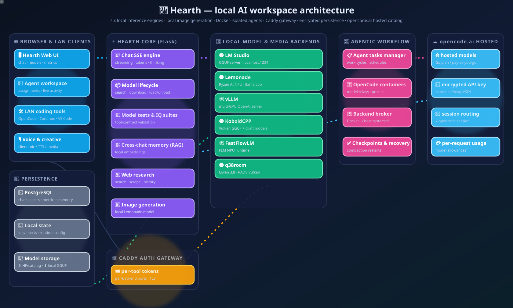
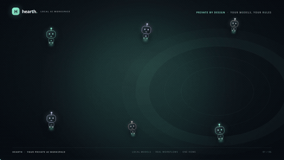
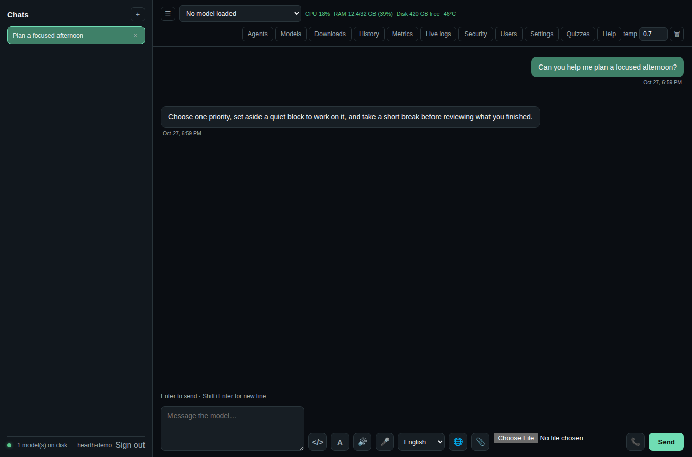
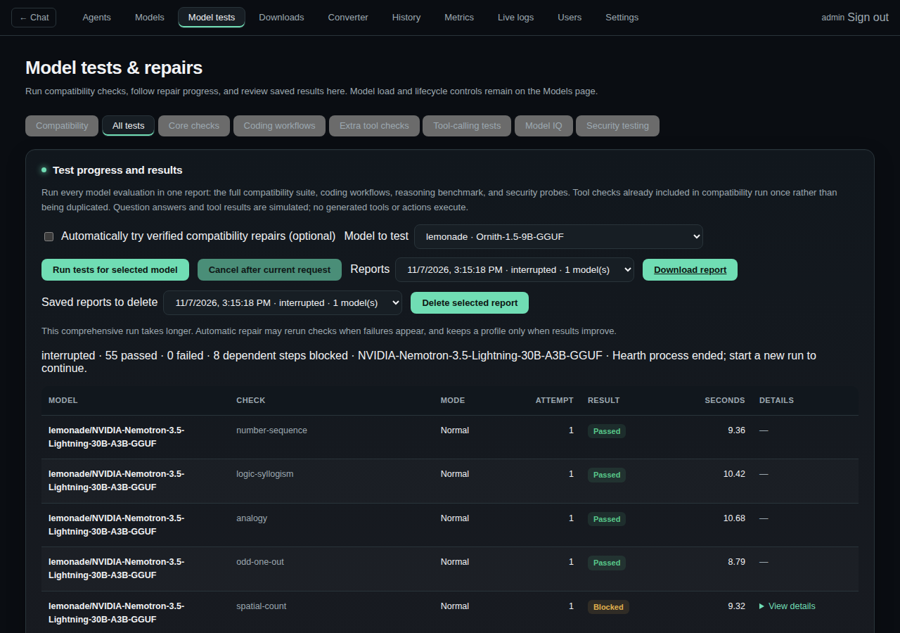

# Hearth

**A self-hosted workspace for local AI chat, model evaluation, and coding agents.**

Hearth brings supported model runtimes into one web app. Chat with local or hosted
models, manage model files, evaluate model behavior, and run OpenCode coding tasks
with live progress. PostgreSQL stores conversations, users, settings, reports, and
agent records; model weights and generated media remain in configured local storage.

[Install Hearth](#installation) · [Features](#features) ·
[Supported backends](#supported-model-backends) ·
[Development](#development)

## Features

| Area | Capabilities |
|---|---|
| Chat | Streamed responses and supported reasoning, saved conversations, model selection, file attachments, and Markdown |
| Model management | Search supported catalogs and Hugging Face, download and upload supported models, load or unload local models, and configure per-model context and reasoning preferences |
| Model evaluation | Compatibility and tool-use checks, reasoning and safety evaluations, saved reports, and user-managed test scenarios |
| Coding agents | OpenCode project tasks, live activity, project checkpoints, verification commands, schedules, and reusable agent skills |
| Research and memory | Web search and browser-based page retrieval, searchable browse history, and cross-chat recall using local embeddings |
| Voice and translation | Microphone transcription, spoken replies, and supported local text, image, and video translation workflows |
| Image and video | Local image generation through Lemonade and Anima-Turbo; text-to-video with Wan 2.2 through Lemonade's bundled sd.cpp runtime |
| Hosted models | Optional opencode.ai catalog access for chat and agent assignments |
| Coding clients | Authenticated OpenAI-compatible endpoints and generated configurations for OpenCode, Continue, and compatible clients |
| Monitoring and learning | Request metrics with scrollable aligned tables, live logs, system statistics, quizzes, and DMV practice tests |
| Administration | User accounts and roles, backend settings, service controls, and host security reports |

Feature availability depends on the configured runtime, installed models, and host
hardware. See the [installation guide](deploy/FIRST_TIME_INSTALL.md) for prerequisites
and operational details.

## Architecture

Hearth provides the web interface and coordinates supported inference backends. It
stores application data in PostgreSQL and keeps model execution in the selected local
runtime or optional hosted provider.

<p align="center">
  
</p>

## Supported model backends

| Backend | Typical use | Notes |
|---|---|---|
| [LM Studio](https://lmstudio.ai) | Local chat and GGUF models | CPU or GPU execution supported by the installed runtime |
| [Lemonade](https://github.com/lemonade-sdk/lemonade) | Local chat, speech, image, and video models | Supports compatible CPU, GPU, and Ryzen AI NPU recipes |
| [vLLM](https://github.com/vllm-project/vllm) | Local model serving | Connect Hearth to a configured vLLM OpenAI-compatible endpoint |
| [KoboldCPP](https://github.com/LostRuins/koboldcpp) | Local GGUF chat models | CPU or GPU execution supported by the installed build |
| [FastFlowLM](https://github.com/ROCm/FastFlowLM) | Ryzen AI NPU chat models | Runs as a separate host service |
| q38rocm | Qwen 3.8 local inference | Optional Radeon Vulkan backend; see the setup guide |
| [opencode.ai](https://opencode.ai) | Optional hosted chat and coding models | Account and plan access are managed by the provider |

On AMD systems with a shared GPU memory pool below 32 GiB, Lemonade automatically
uses CPU inference for models whose weights exceed half that pool, to avoid Vulkan
memory exhaustion. Replies may be slower.

### Observed local model speeds

These are peak successful generation speeds recorded by this Hearth installation
through **November 18, 2026**, on an AMD Ryzen AI 9 HX 470 system with Radeon 890M
graphics, 12 CPU cores / 24 threads, and 43.7 GiB RAM. They are observations from
different prompts, context sizes, model quantizations, and backend settings, not
controlled benchmark scores. The sample count is the number of successful measurements
for each model. Hosted models are omitted because they run on remote hardware.

| Backend | Model | Peak recorded speed (tokens/s) | Samples |
|---|---|---:|---:|
| FastFlowLM | `llama3.2:1b` | 51.00 | 106 |
| FastFlowLM | `minicpm-v-4.7:1b` | 40.80 | 270 |
| FastFlowLM | `qwen3.5:2b` | 22.70 | 244 |
| FastFlowLM | `qwen3.8-mtp:27b` | 4.30 | 278 |
| KoboldCPP | `Qwen3.8-2B-Q8_0` | 19.10 | 274 |
| Lemonade | `Devstral-Small-2507-GGUF` | 2.80 | 475 |
| Lemonade | `esatapedico-Qwen3.8-27B-NVFP4-MTP-GGUF` | 7.10 | 1,259 |
| Lemonade | `Gemma-4-26B-A4B-it-GGUF` | 10.30 | 500 |
| Lemonade | `Gemma-4-26B-A4B-it-MTP-GGUF` | 18.80 | 500 |
| Lemonade | `GLM-4.7-Flash-GGUF` | 14.70 | 876 |
| Lemonade | `granite-4.0-h-tiny-GGUF` | 29.80 | 224 |
| Lemonade | `K2-Horizon-32B-GGUF` | 1.91 | 268 |
| Lemonade | `K2-Horizon-MoVA-36B-A4B-GGUF` | 10.90 | 1,492 |
| Lemonade | `mradermacher-Moon-Beam-16B-A3B-i1-GGUF` | 21.10 | 333 |
| Lemonade | `Muse-Glimmer-30B-GGUF` | 8.00 | 1,844 |
| Lemonade | `NVIDIA-Nemotron-3.5-Lightning-30B-A3B-GGUF` | 17.60 | 387 |
| Lemonade | `Ornith-1.5-35B-A3B-GGUF` | 19.30 | 214 |
| Lemonade | `Ornith-1.5-9B-GGUF` | 16.40 | 531 |
| Lemonade | `PhillyLabs-KAT-Coder-V2.5-Dev-35B-A3B-ABLITERATED-UNCENSORED-PHILADELPHIA-CLASS` | 14.90 | 575 |
| Lemonade | `PhillyLabs-Qwen3.8-27B-ABLITERATED-UNCENSORED-PHILADELPHIA-CLASS` | 2.30 | 259 |
| LM Studio | `mimo-v2.6-distill-qwen-9b` | 7.11 | 200 |
| LM Studio | `qwen3.8-2b-distill` | 29.70 | 479 |
| q38rocm | `Qwen3.8-27B-Q3_K_M` | 2.80 | 538 |

For a repeatable comparison, test each model with the same prompt, context size, and
backend configuration.

The local backends are optional except for components required by a chosen feature.
Hearth does not bundle model weights. Check each model's license and hardware needs
before downloading it.

## Screenshots

[](docs/screenshots/hearth-feature-demo.mp4)

| Chat | Models |
|---|---|
|  |  |

| Model tests | Coding agents |
|---|---|
|  |  |

## Installation

Choose the setup path that matches your host:

- **Ubuntu:** From the project checkout, run `bash deploy/install-first-time.sh`. This
  installs and configures the app, PostgreSQL, and required host components.
- **Windows, macOS, or Linux release bundle:** Download a matching bundle from GitHub
  Releases and follow its included setup instructions.
- **Linux Docker deployment:** Run `bash deploy/install-docker.sh` for the containerized
  app deployment.

The first visit prompts you to create the administrator account. Configure at least
one model backend in **Settings**, then download and load a model from **Downloads** or
**Models**. See [deploy/FIRST_TIME_INSTALL.md](deploy/FIRST_TIME_INSTALL.md) for the
complete installation, backend, networking, and maintenance instructions.

## Local model evaluation

The **Model tests** page evaluates supported chat models with compatibility, reasoning,
safety, and tool-use checks. Results include per-check details and response previews.
Administrators can also create reusable test scenarios with expected answers. These
checks help compare configurations; they do not certify model quality or host security.

## Coding agents and client access

Hearth can run project tasks through OpenCode in isolated agent environments. Tasks can
include project files, requirements, verification commands, and reusable skills. The
Agents pages show progress and results, and support scheduled work where configured.

For desktop or LAN coding clients, Hearth can generate OpenCode and Continue
configurations for supported model endpoints. The gateway uses authentication and TLS;
remote access can use Tailscale when the host and client devices are configured for it.
Hearth does not configure tailnet access policies for you.

## OpenCode context compaction

OpenCode compaction budgets scale with the selected model's loaded context. When Keep
and Buffer are blank, Hearth calculates them as follows:

```text
buffer         = max(1, context // 12)
prompt_reserve = max(1, context // 64)
keep           = max(0, context - buffer - prompt_reserve)
```

For a 65,536-token context, this yields a 5,461-token buffer, a 1,024-token prompt
reserve, and 59,051 tokens to keep. Explicit settings are bounded so the combined
budget fits the loaded context.

## Data, access, and safety

- PostgreSQL stores accounts, conversations, settings, model-test reports, metrics, and
  agent task records. Back up PostgreSQL and any local files you want to retain.
- Model files and generated media are stored in configured local directories or backend
  caches. Their storage requirements depend on the models you choose.
- User accounts and roles protect Hearth pages. The coding gateway uses separate
  authenticated endpoints; configure TLS and network access for your environment.
- Chat requests go to the selected local backend or optional hosted provider. Web
  research and other integrations may contact the providers you configure.
- **Use at your own risk.** Hearth is not a platform for investment advice, including
  advice about stocks, securities, tickers, Nasdaq or S&P indexes, index funds, ETFs,
  or trading. It is not a healthcare provider and does not provide medical advice,
  diagnoses, or treatment plans. Consult qualified financial or medical professionals
  for decisions in those areas; seek emergency care for urgent medical concerns.
- Hearth is not responsible for model-generated results, errors, or decisions made
  from them. Model responses may be inaccurate or unsuitable; review them and check
  model licenses and provider terms before use.

## Development

Application code is organized under `hearth/` by domain. `app.py` is the web entry
point, `deploy/` contains installation and service configuration, and `tests/` contains
the regression suite.

Run the project checks from the repository root:

```bash
.venv/bin/python tools/run_tests.py
```

To include browser coverage:

```bash
.venv/bin/python tools/run_tests.py --browser
```

For environment setup and deployment options, see the
[installation guide](deploy/FIRST_TIME_INSTALL.md).
