# Hearth: A Home for Your Local AI

*Chat with local models, test how they work, and follow coding agents from one self-hosted workspace.*

Hearth brings your local AI tools together in one browser app. Chat with models
running on your own hardware, compare how they handle coding tasks, and follow
OpenCode agents as they work. Conversations, settings, and agent projects are kept
in your own PostgreSQL-backed installation.

Choose from supported CPU, GPU, and AMD Ryzen AI NPU backends. Hearth also includes
an OpenAI-compatible gateway for coding clients, model search and downloads, web
research, voice tools, and cross-chat memory. Add Tailscale when you want private
remote access to your home setup.

[Get started](#first-time-setup) · [Explore features](#what-you-can-do-with-hearth) ·
[Test models](#local-llm-testing-and-tool-calling-evaluation) ·
[Use coding agents](#agentic-ai-and-local-coding-agents) ·
[Personal AI](#a-personal-ai-assistant-on-your-own-hardware) ·
[Search and download models](#search-download-and-manage-local-ai-models) ·
[Secure coding gateway](#secure-model-gateway-for-opencode-continue-and-vs-code) ·
[Tailscale remote access](#tailscale-remote-access-for-chat-and-coding-models) ·
[All features](#current-feature-directory)

> Hearth uses PostgreSQL 18 through Docker Compose. The first-time installer
> starts a clean database, loads the application DDL, creates the initial admin,
> and configures the app to start automatically after reboot. See the
> [installation guide](deploy/FIRST_TIME_INSTALL.md) for setup details.

## Architecture at a glance

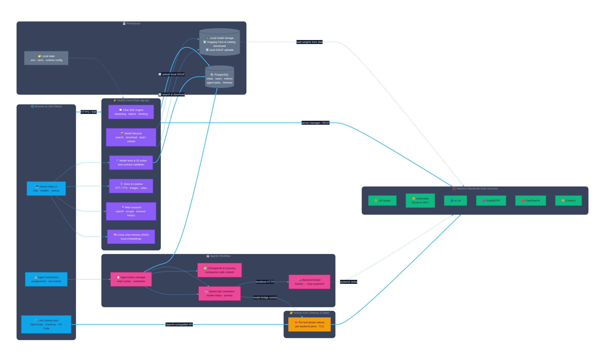

<p>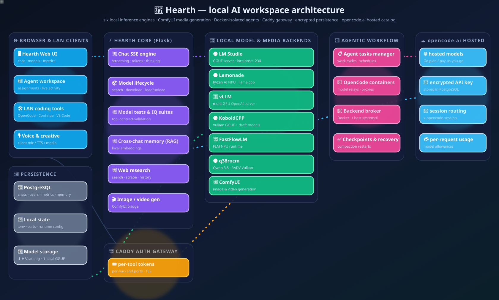</p>

<p align="center"><em>Animated SVG overview — flows and packets move; falls back to a static
picture where animation is unavailable.</em></p>

<details>
<summary>Diagram source (Mermaid)</summary>

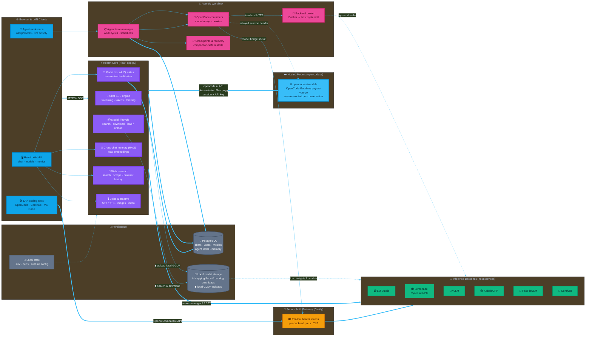

</details>

*Browser clients and LAN coding tools reach isolated parts of Hearth directly; everything
running the models stays behind peer-reviewed host services, while agent containers and
their model relays bridge Docker-isolated OpenCode workers back to your local hardware —
and hosted opencode.ai models (with the account plan, encrypted API key, and per-conversation
routing session configured in Settings) are one more backend away.*


A small Flask web UI for chatting with local models, with sidebar controls to load/unload
models and switch which loaded model you're chatting with. Hearth started as an LM Studio
front-end and now drives **six** local inference backends behind one chat UI — [LM Studio](https://lmstudio.ai), [Lemonade / Ryzen AI NPU](https://github.com/lemonade-sdk/lemonade),
[vLLM](https://github.com/vllm-project/vllm), [KoboldCPP](https://github.com/LostRuins/koboldcpp),
the q38rocm Qwen 3.8 server, and [FastFlowLM](https://github.com/FastFlowLM/FastFlowLM) (the Ryzen AI NPU runtime run
standalone) — plus ComfyUI for image generation — and the opencode.ai hosted catalog
(OpenCode Go subscription or pay-as-you-go) routed per conversation through its
OpenAI-compatible endpoint. Local backends are exposed to LAN coding tools
(Continue, OpenCode) over their own authenticated Caddy reverse-proxy ports (see **Help**).
Local models have the Search / Download / Load / Unload / Delete lifecycle from the Models and
Downloads pages; hosted opencode.ai models are remotely managed and cannot be unloaded or
deleted from Hearth. Beyond chat it also does cross-chat memory (RAG), auto-detected web search,
voice in/out, a performance-metrics board, and an in-chat practice-test/quiz platform —
all documented in their own sections below.

## What you can do with Hearth

Lemonade requests with tools disabled omit tool schemas before reaching the runtime,
preventing native tool parsers from rejecting ordinary answers.

| Use case | Included capabilities |
|---|---|
| Local and hosted AI chat | Streamed answer and reasoning updates during generation, saved conversations, document attachments (PDF, Word, PowerPoint, Excel, TXT, and CSV) for analysis and follow-up questions, automatic recent-context fitting based on each model's reported context limit, reliable SSE streaming through the local model proxies, copy individual responses or an entire conversation, model switching (local or hosted opencode.ai), and supported reasoning displays |
| Model management | Search, download, upload local GGUF files to Lemonade, load, unload, and delete models through supported local backends; hosted opencode.ai models are marked as remotely managed and do not trigger local unload prompts; restart backend services or Hearth from admin Settings; set per-model thinking for Lemonade models and see supported context limits on the Models page. Lemonade load failures that are transient (a `500` during a cold load of a large model, or a connection error while the backend process is spawning) are retried automatically a bounded number of times before surfacing as an error; permanent rejections such as an unknown model or not-enough-RAM fail immediately. Lemonade loads are verified after the API reports success — if the model does not appear in the loaded list (e.g. insufficient memory), a clear error is raised instead of a silent failure. The default context window for Lemonade models is 8192 tokens for loading; users can raise it per-model via the Models page or OpenCode context settings when the model supports more. Backend restarts can be selective (choose which backends to restart) and track progress via `/api/admin/restart-status/<job_id>`; restarts preserve mandatory support models (RAG/embedding, STT, TTS). Hearth no longer auto-loads models on startup or restart; all models must be loaded manually from the Models page (support models still lazy-load on demand). The default LAN model is set to K2-Horizon-MoVA-36B-A4B-GGUF (Lemonade). Service status and restart history are tracked in PostgreSQL tables (`service_status`, `restart_jobs`, `model_load_events`), and model load/unload errors are recorded with full error text for copy/display. The metrics page includes a model test report table showing pass/fail/skip counts, pass rate, and a recommended model based on test results. On startup, Hearth records its own service status as 'started' and checks all backend services, so stale 'restarting' states from a previous restart are corrected. If Lemonade is temporarily unreachable, a load request for a Lemonade-served model now reports a clear 'Lemonade is unreachable' error instead of silently falling through to LM Studio (which previously produced a confusing 'No model found' message) |
| LLM evaluation | Compatibility and tool-calling tests, a scored reasoning benchmark, security behavior probes, saved reports, and per-question results |
| Agentic coding | OpenCode project tasks with a configurable per-turn step limit, progress monitoring, user-input handling, and configured verification commands |
| Agent skills | A per-user skill library: add, edit, upload, download, and import skills as SKILL.md instruction packs installed into agent containers |
| Personal AI memory | Cross-chat memory retrieval with local embeddings and stored conversation history |
| Web research | Relevance-ranked web search, broad configurable Playwright page retrieval, ad/tracker blocking, read-only chat browser research, and searchable AI browser history |
| Voice assistant | Microphone input, speech transcription, and spoken responses with configured voice components |
| Creative tools | Image and video generation through separately configured ComfyUI workflows |
| Learning | In-chat practice tests and quizzes |
| Hosted models (opencode.ai) | Free `-free` tier models, the $10/month OpenCode Go subscription, or pay-as-you-go credits — usable for chat, codebase-RAG chat, and agentic tasks; plan selection and encrypted key storage in Settings | Settings → opencode.ai |
| Performance monitoring | Request metrics, token usage, generation speed, and a dedicated live developer logs page |

## Hearth in action

Watch the [25-second Hearth feature demo with sound](docs/screenshots/hearth-feature-demo.mp4).
The animated preview below is silent; open the video for the original music and sound effects.

[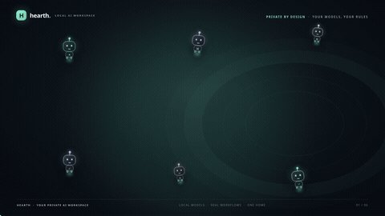](docs/screenshots/hearth-feature-demo.mp4)

Screenshots show the chat workspace, local model controls, model evaluation, the
agent task editor, performance metrics, live request logs, and AI browser history.
Chat and agent setup use fictional demo text. Metrics, live-log, and browser-history
screenshots show their empty states.

| Sign in to Hearth | Agents moving between workflow steps |
|---|---|
| 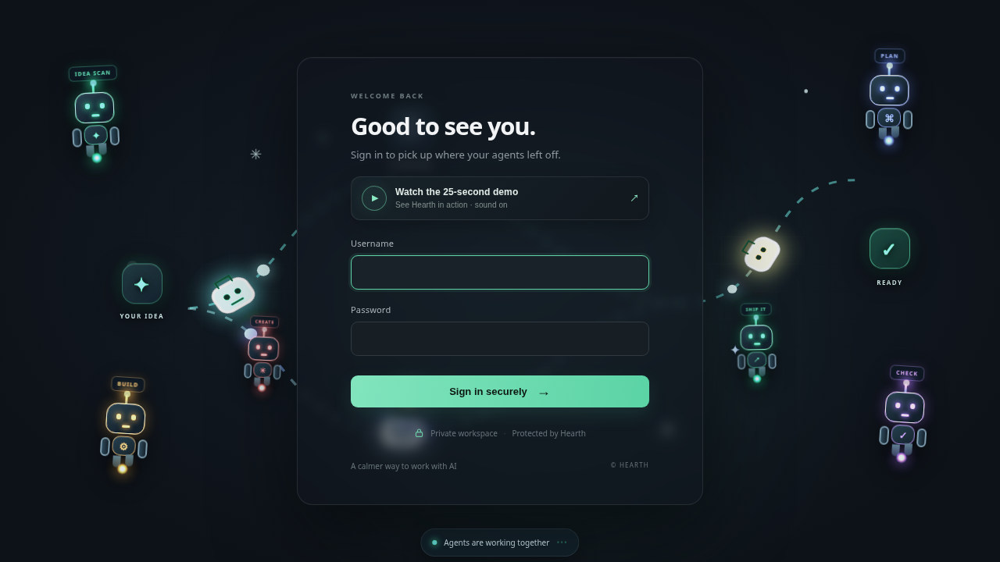 | 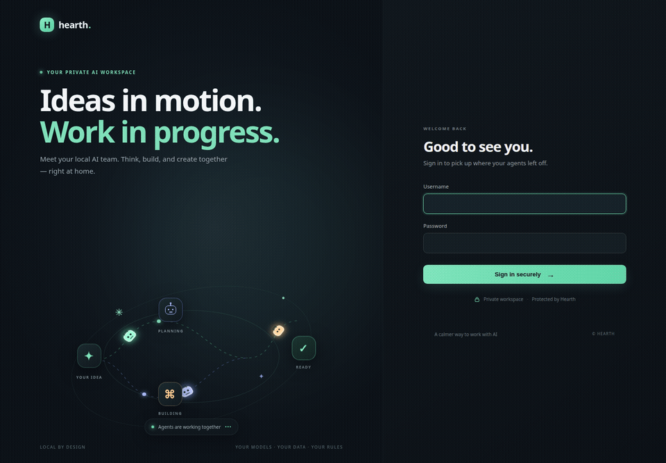 |

| Find and download a model |
|---|
| 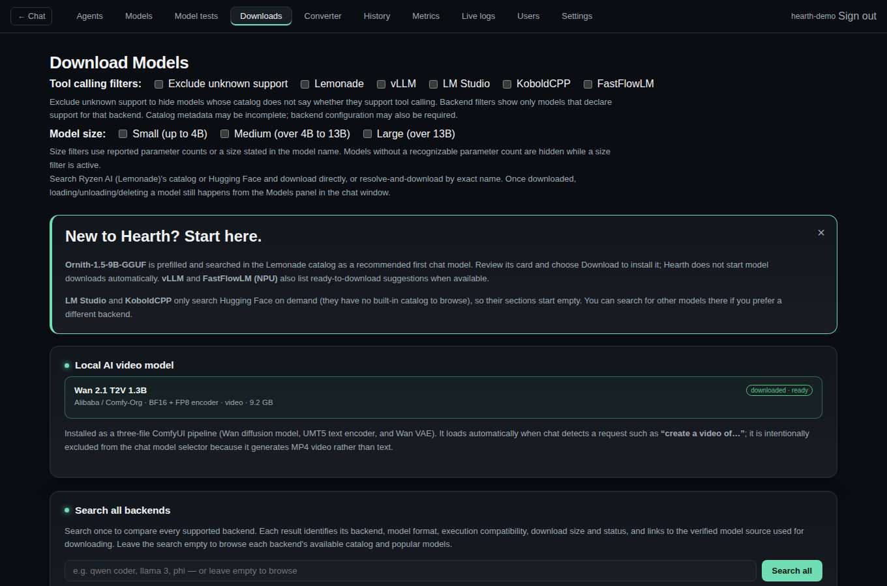 |

| Chat with a local model | Manage local models |
|---|---|
| 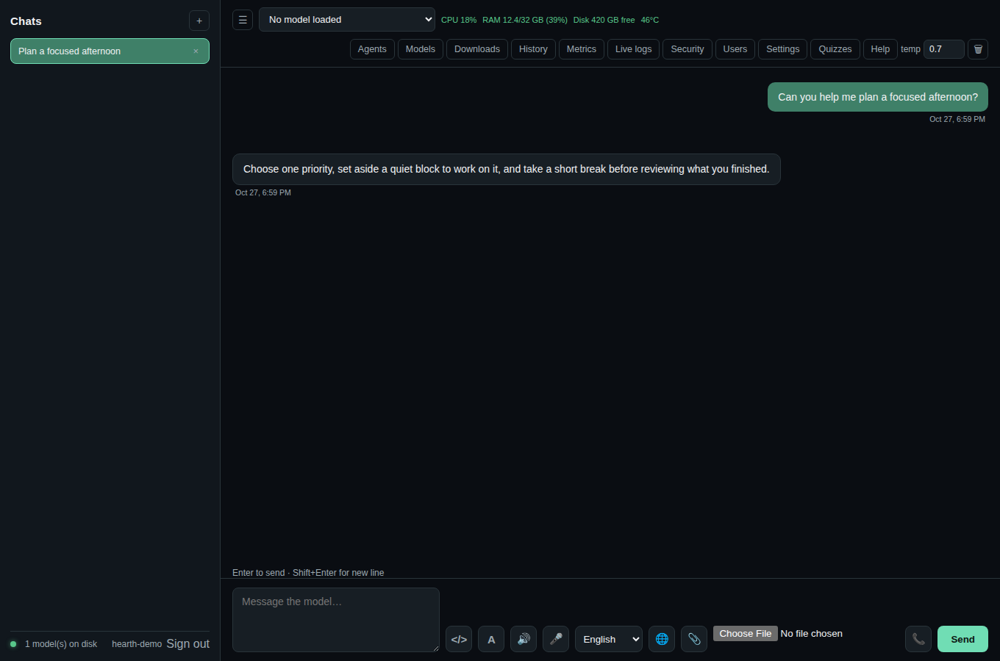 | 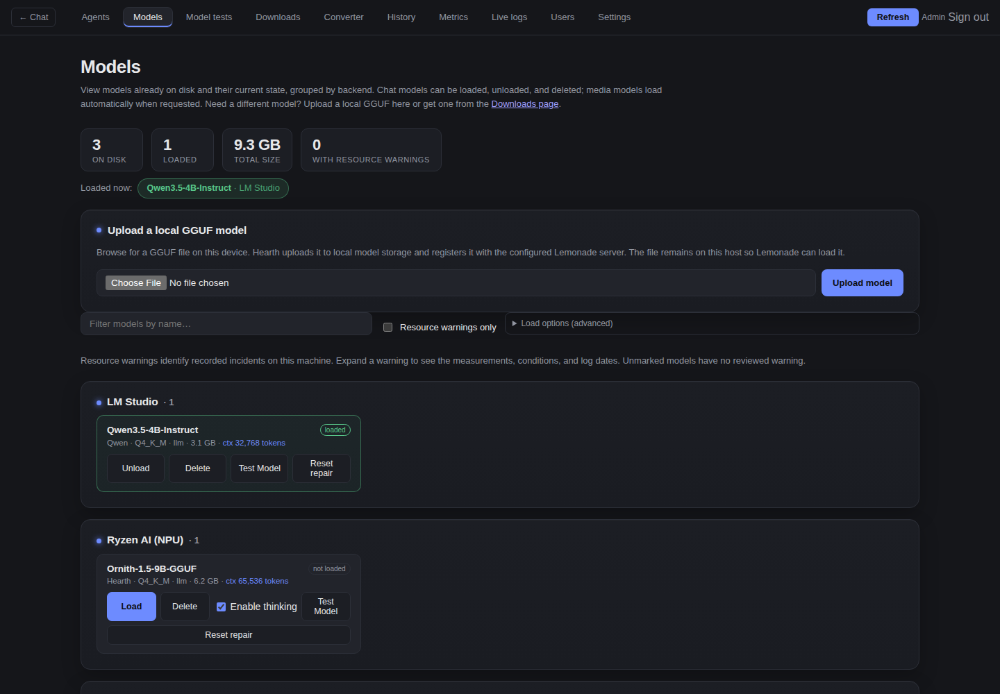 |

| Evaluate model behavior | Set up an agent task |
|---|---|
| 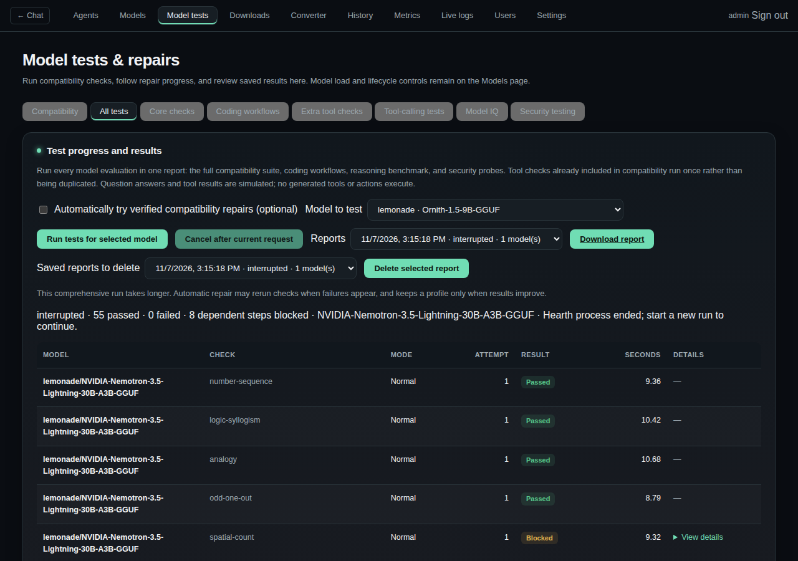 | 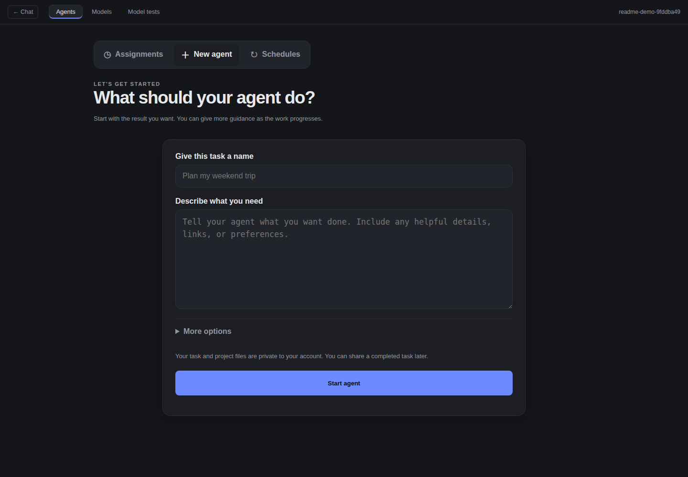 |

| Review performance metrics | Inspect live request logs |
|---|---|
| 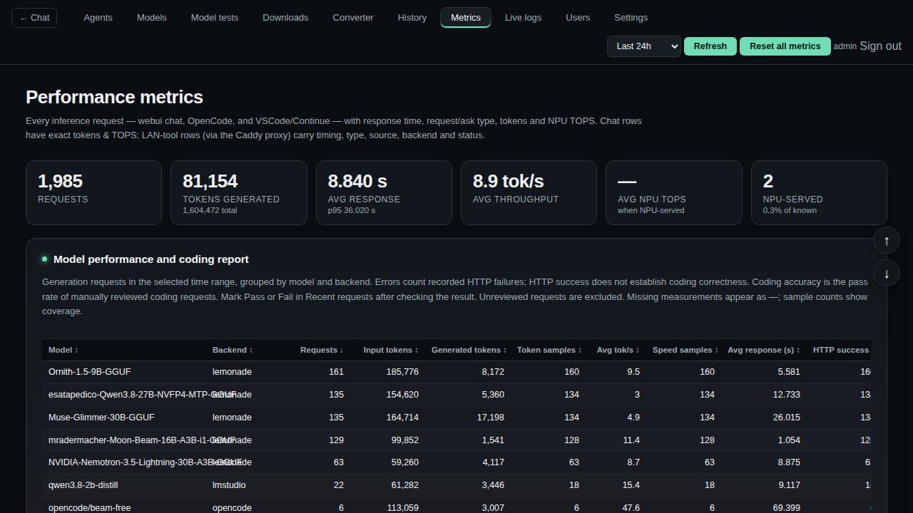 | 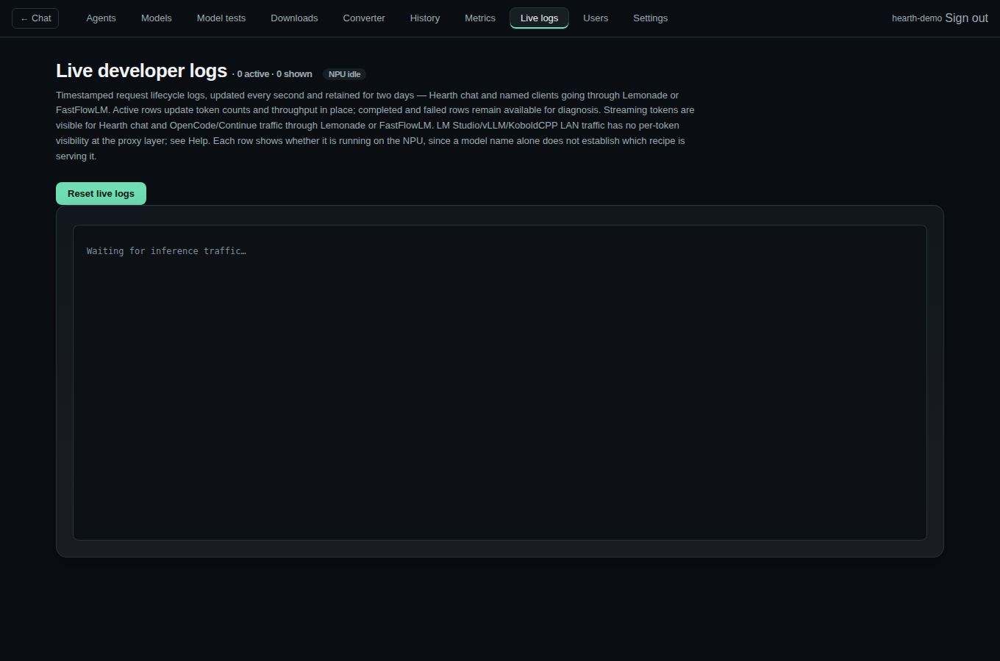 |

| Review AI browser history |
|---|
| 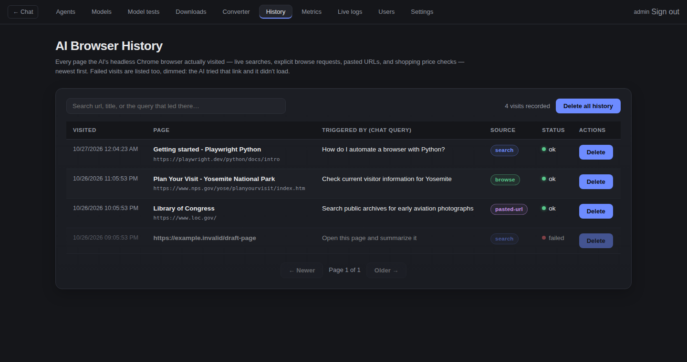 |

## Search, download, and manage local AI models

Hearth combines **local model discovery, Hugging Face model search, model downloads,
and model management** in one browser interface. Open **Downloads** as an
administrator to find models, then use **Models** to load and evaluate them.

1. Use **Search all backends** to search LM Studio, Lemonade, vLLM, KoboldCPP,
   FastFlowLM, and q38rocm together, or search a single backend. Leave the search field
   empty to browse each backend's available catalog or popular Hugging Face models.
2. Compare result cards by backend, model format, execution compatibility, download
   size, task type, update date, popularity, download status, and source link. Each
   card labels tool-calling support as **yes**, **no**, or **unknown**, based on
   catalog metadata.
3. Use **Exclude unknown support** to hide models whose catalog does not say
   whether they support tool calling; models marked **no** remain visible. The
   independent **Tool calling filters** restrict selected backends to models whose
   catalog metadata explicitly declares support. A positive label does not guarantee
   compatibility with every tool or runtime, so use **Model tests** before relying on it.
4. Filter by parameter count with **Small** (up to 4B), **Medium** (over 4B through
   13B), or **Large** (over 13B). These filters use reported parameter counts or
   recognizable sizes in model names/descriptions; models without a detectable
   count are hidden while a size filter is active. Clear the size checkboxes to
   show all sizes again.
5. **Downloads** opens with the recommended Lemonade `Ornith-1.5-9B-GGUF` search
   selected. During first-time Ubuntu setup, the installer offers to download this
   model before starting the service when Lemonade is reachable. It shows the catalog
   size, free disk space, available RAM, and an example transfer time, then requires
   your confirmation. You can decline or pass `--skip-model-download` and download it
   here later. Follow progress and logs, inspect active downloads, or
   cancel a download.
6. To use a model file already on your device, choose **Upload a local GGUF model**
   on Models, browse to a `.gguf` file, and upload it. Hearth validates the GGUF
   header, stores the file under `data/local-models`, and registers it with the
   configured Lemonade server. That server must run on the Hearth host or be able to
   read the stored file path. The upload transfers the full model file to Hearth;
   ensure the host has enough disk space. The model then appears in **Models**.
7. Open **Models** to load, unload, or delete installed models. Select a loaded
   chat model in the conversation model picker. Deleting a model is blocked while
   active agent work or a model test run uses that same model; other offline models
   remain available for deletion. For LM Studio models, Hearth resolves catalog aliases
   through LM Studio's installed model index and verifies the model entry under its models
   directory before removing its folder. Model files may link into the Hugging Face cache;
   Hearth removes those links without traversing their targets. A failed load is shown on
   its model card and refreshed across open Models pages every five seconds; the current
   error clears after Hearth confirms a successful load. Reviewed model warnings stay
   dismissed after a successful load and return if a later load attempt fails.
8. Check the maximum context-token label shown on a **Downloads** result when
   metadata reports it. In **Models**, check the context limit shown on each label when choosing
   how much chat history to send. The displayed limit is the model/backend
   capability Hearth knows about; runtime settings can impose a lower active
   context size.
9. On a Lemonade model card, use **Enable thinking** to choose whether Hearth chat requests
   include that model's reasoning phase. The toggle is saved per model and overrides the
   Lemonade default in Settings; Hearth passes it through both Lemonade's request control and
   the chat-template option. Models whose runtime does not support thinking controls may ignore it.
   Disabling thinking also applies to model tests and coding clients using Hearth's Lemonade
   gateway, including requests with thinking enabled in an older client configuration or agent
   assignment. Restart Hearth and `lemonade-guard-shim.service` after updating. The change
   applies to new requests; CPU inference and large conversation histories can still be slow.
10. Run **Model tests** before using a model for coding or tool-driven workflows.

| Backend | Model discovery and download sources | Execution |
|---|---|---|
| LM Studio | Hugging Face GGUF search; direct model name or repository URL | CPU/GPU as supported by LM Studio |
| Lemonade | Curated catalog and Hugging Face search, including GGUF models | CPU/GPU/NPU according to model recipe and hardware |

Search all backends also checks Lemonade's latest public catalog and LM Studio's
published model catalog. When the installed Lemonade server has an older catalog,
new public GGUF entries appear as Hugging Face downloads; LM Studio catalog matches
link to their verified GGUF artifacts. Public catalog searches need internet access.
| vLLM | Catalog and Hugging Face causal language model repositories | Depends on the installed vLLM runtime; the documented host uses CPU |
| KoboldCPP | Hugging Face GGUF search and downloads | CPU/GPU according to the installed build |
| q38rocm | `julianmb/Qwen-3.8-27B-ROCmFP4-FAST-GGUF`, shown under its actual Hugging Face repository ID | One locally installed Qwen 3.8 GGUF in `data/q38rocm/models`; q38rocm fork built with RADV Vulkan on this desktop; one model served at a time |
| FastFlowLM | FastFlowLM NPU catalog and exact model tags | Supported AMD Ryzen AI NPU hardware |

For a one-command Hearth plus q38rocm setup on Ubuntu or Debian, run the combined
installer from this checkout:

```bash
bash deploy/install-hearth-q38rocm.sh
```

It uses `Qwen3.8-27B-Q3_K_M.gguf` if it is already in the backend folder or
there is exactly one copy in the Hugging Face cache. Otherwise pass its path as
the first argument. The model weights are not downloaded by the installer. It
uses `sudo apt-get` to install system dependencies, then copies the model,
builds q38rocm, installs its on-demand service, and runs Hearth's standard
first-time installer. It installs Mesa RADV and Vulkan runtime/tools for Radeon
GPU acceleration, then reports whether Vulkan detects the GPU. Additional options
such as `--skip-browser` are passed to the Hearth installer after the model path.

On Radeon 890M (gfx1150), the build script configures the fork for RADV Vulkan
hardware acceleration and the service defaults to a 131,072-token loaded
context (model maximum: 262,144), with FP16 KV cache and the `speed` profile.
Logical batches are 2,048, physical microbatches are 64 to bound workspace,
and prompt caching is limited to 2 GiB. Flash Attention is disabled: the pinned
engine produces corrupted Qwen output with it enabled on this Radeon, including
with FP16 cache; CPU and Vulkan without Flash Attention return correct calls.
Hearth disables MTP for this Vulkan
device: upstream reports roughly 0% MTP draft acceptance on Vulkan0 in the current
engine, while MTP is supported on ROCm0. The service defaults reasoning off, and
Hearth can enable it per model and per chat request. Upstream's higher published decode rates
were measured on a Radeon 8060S, not this 890M, so they do not describe this host's
expected speed. At the default context the attention KV cache is approximately 8 GiB;
full-context prefill and generation can be slow, and available shared GPU memory
determines whether the full window loads successfully. The model
appears on the Models page; Hearth starts and stops `q38rocm.service` from its
Load/Unload controls. The Models page includes a per-model **Enable thinking**
toggle for q38rocm. It is off by default and is sent with each Hearth chat
request, so it can be changed without restarting the backend. q38rocm appears
in the Model tests selector; compatibility checks still disable reasoning for
concise, repeatable checks.
The upstream checkout also provides optional host-level clock and TTM/GTT tuning
(`sudo bash data/q38rocm/apply_hardware_tweaks.sh`) for systems where GPU memory
limits constrain allocation. It changes runtime kernel settings and requires root.
Administrators can also restart a loaded q38rocm service from **Settings → Service
controls → Restart q38rocm**; the same service is included in **Restart all backends**.
This backend serves local Hearth chat and model tests, and is not included in
LAN or Tailscale coding-client configurations. The desktop OpenCode sync adds
it to `~/.config/opencode/opencode.jsonc` while the model file is installed;
q38rocm uses its service sampling defaults unless a caller supplies an override;
explicit frequency penalties are supported. Chat and model tests share the same
request adapter. The model's Qwen XML tool template is supported by the installed
engine; Hearth keeps OpenAI-shaped messages and schemas on the wire. Named
function choices use `required` with only the selected tool's schema because this
server build accepts only auto/none/required choice strings. Thinking preferences
are passed as boolean `chat_template_kwargs.enable_thinking` values.
Compatibility tests default reasoning off and preserve each fixture's output
budget (normally 512 tokens for chat and 2,048 for tool requests); they do not
silently reduce tool replies to 64 tokens. The large-code fixture is limited to
about 4K input tokens. Larger output budgets can take several minutes on this GPU.
The synthetic overflow probe is skipped for this large-context backend because
building an over-limit prompt requires a costly full-window prefill. Other backends
keep the full fixture and overflow probe. Hearth also forwards q38rocm's OpenAI-compatible
tool-choice, parallel-call, and reasoning-template options instead of dropping them.
Streaming requests ask q38rocm to include usage in its final event so prompt and
completion token counts appear in Hearth Metrics.
For standalone checks use `.venv/bin/python -m tools.test_flm_model --backend q38rocm
--url http://127.0.0.1:8008/v1/chat/completions --model '<served model ID>' --suite core`.
Read the served ID from `/v1/models`; UI runs resolve it automatically. The
standalone q38rocm option uses the same adapter and bounded input fixture as UI runs.
It defaults to the saved q38rocm endpoint and uses its saved API key when targeting
that endpoint. Deliberately skipped probes do not make the CLI exit with failure.
Model-test reports retain the backend's decode and prefill timing rates when supplied,
so prompt-processing time is not counted as token decoding time.
See the [installed q38rocm schema audit](docs/q38rocm-schema-audit.md) for verified
model metadata, request compatibility, and the Flash Attention diagnosis.
Existing installations apply this fix with `bash deploy/install-q38rocm-service.sh`
followed by `systemctl --user restart q38rocm.service`.
To request a different window, set `Q38ROCM_CONTEXT` when running the service
installer (1,024–262,144 tokens). Larger windows require more GPU memory; this
desktop could not allocate the corrected 262K configuration. Hearth reads the
loaded window from the backend and retains 262K as the model's maximum.
Model-test handoff checks read each backend's live inventory, so stale loaded-state
metadata in the combined Models view does not produce a false setup failure.
In Hearth chat, structured OpenCode question calls retain the requested single- or
multi-select mode when a backend omits that optional field.
load it from Hearth's Models page before selecting it in local OpenCode. It runs
separately from Lemonade and the Ryzen AI NPU. The supported service setup expects
`Qwen3.8-27B-Q3_K_M.gguf`; this is a Q3_K_M quant, not a ROCmFP4 FAST file. The
Downloads page lists the julianmb repository under q38rocm and downloads its
compatible Q3_K_M file into the backend directory, reusing the file from
Lemonade's Hugging Face cache when present. Hearth no longer lists this catalog
entry as a Lemonade model. Downloads shows the repository as
`julianmb/Qwen-3.8-27B-ROCmFP4-FAST-GGUF` rather than a generated slug.

Muse models, including Lemonade catalog entries such as the Muse-Glimmer family,
are used through the Lemonade backend. Configure Lemonade in **Settings**, confirm
the model appears in **Models**, and select it for chat or an agent assignment.
Muse model availability, context limits, tool behavior, and hardware requirements
come from the installed Lemonade server and its model recipe; Hearth does not
download Muse weights as part of application setup. Use **Model tests** before
depending on a Muse model for tools or coding work.

A model appearing in search does not establish that it fits your hardware or
supports every feature. Hearth includes resource checks and load feedback; runtime
compatibility, available memory, context size, and model capabilities still apply. The
shared load preflight keeps the current model loaded when available RAM can fit the
incoming model's known weight size plus 1 GB headroom. Otherwise Hearth evicts the
current model first; backend-specific model-size checks still apply.
Embedding, speech, image, and video models have separate purposes from chat models.

On **Models**, each model label includes its maximum supported context-token count
when the backend reports or Hearth can determine it. This helps compare model
limits before loading or chatting; the actual usable context may be lower when a
runtime or backend setting applies a smaller value. Chat models on Lemonade, LM
Studio, vLLM, and KoboldCPP also show a **ctx-size** field. KoboldCPP reads its
maximum from the installed GGUF metadata. Saving the field stores the window for
that model and reloads it when it is already loaded; the saved value is reused on
every later load. Enter the reported maximum (for example a model loaded at 13,835
of a 131,072-token window) to use the full window. **Set all to max context** saves
each adjustable chat model's reported maximum in one step; it applies to loaded models on their
next Load. Generated LAN and Tailscale configurations (OpenCode and Continue) use the
actual served window for a loaded model and the saved value for an unloaded model.
Reload a loaded model from Models to activate its saved maximum. Only select a value your hardware can actually hold in memory;
larger windows use more memory and can make loads slower or fail.
FastFlowLM uses per-model NPU kernel limits that Hearth cannot raise. q38rocm uses
the installed service's context setting; on this desktop its 131,072-token setting
fits the available GPU memory, while the model's 262,144-token maximum did not.
Generated desktop OpenCode configuration uses that installed q38rocm setting.

For Lemonade's `Ornith-1.5-35B-A3B-GGUF`, Hearth selects the CPU backend on AMD
devices with a shared GPU memory pool below 32 GiB to avoid Vulkan memory exhaustion
during loading. CPU inference uses system RAM and can produce slower replies. Restart
Hearth and the Lemonade gateway after updating, then reload the model from Models.

If loading a Lemonade model reports that LM Studio cannot be reached, start LM
Studio's configured API server (locally, `lms server start --port 1234`) and retry
from Models. Hearth verifies other backends before switching reasoning models,
even when the requested model belongs to Lemonade. On Linux, the LM Studio
service can appear active while its API server has stopped; check the endpoint
rather than relying on service status alone.

### Model picks for faster replies

For a smaller desktop that can fit a quantized 9B model, my recommended
all-around pick is [Ornith-1.5-9B-GGUF](https://huggingface.co/ornith-ai/Ornith-1.5-9B-GGUF),
starting with its **Q4_K_M** quantization. It is a dense 9B model distributed in
GGUF for local inference, giving a stronger quality and capability balance than
the tiny models below while remaining practical on a desktop. Actual memory use
and speed depend on quantization, context length, and how much work can run on the
GPU.

For quick everyday chat on a supported Ryzen AI NPU, start with FastFlowLM's
`qwen3:0.6b`. On the documented host it produced about **57 generated tokens per
second** in a live chat request. Its small size helps response speed, while larger
models are generally a better fit for complex reasoning and coding tasks.

For a compact model that can also handle tool calling, **Qwen3.8-2B-Distill** is
another fast option. It has worked for tool-driven tasks on this setup and is a good
pick when a larger coding model feels slow.

For coding on that host, the measured KoboldCPP setup with Qwen3 8B and Qwen3
0.6B speculative decoding produced about **5.1 tokens per second**, compared with
**4.3 tokens per second** without speculative decoding. Long coding histories can
still make prompt processing slow; use a GPU-backed model that fits your hardware
and keep context focused when turnaround matters. These are measurements from one
machine and model configuration, not speed guarantees. Compare your own backend and
model in **Metrics**, since hardware, quantization, context length, and workload all
affect response time.

## Test and compare models before coding

On LM Studio model cards, administrators can turn **Enable thinking** off for an
individual model. Hearth applies that preference to chat, model tests, and gateway
requests. The setting is saved in PostgreSQL and takes effect on the next request;
some models may ignore the thinking controls.
LM Studio OpenCode assignments send both supported thinking controls. During a
tool-enabled stream, Hearth forwards reasoning updates as they arrive while it
buffers tool arguments for validation, so agent progress stays visible.

The Model tests page groups eight suites into tabs: the full compatibility run,
**All tests** combines the full compatibility run with reasoning and security probes
in one report; core checks cover chat, streaming, tool choice, typed arguments, file-tool contracts, and
the large-code context input), the long OpenCode coding workflows as their own
tab, extra tool-behavior checks (forced named choices, none-when-tool-requested,
tool-error follow-up, the blocked-shell contract, and context-overflow handling
(rejection or truncation within the reported token window)), tool-calling tests,
a 12-question reasoning benchmark, and 10 model security behavior probes.
The reasoning benchmark presents each original question separately, checks it against
a fixed answer key, and reports points correct. It is not a human IQ measurement:
human IQ scores depend on standardized, normed psychological assessments and must not
be inferred from this model benchmark. The security suite probes response behavior
for injection, disclosure, unsafe requests, privacy, and unauthorized actions; it
does not scan the host or prove the model or deployment secure. Tool calls are never
executed by these suites. Results and individual check details are saved with the
existing model-test reports.
During Hearth chat, tool-enabled backend requests explicitly allow parallel tool
calls so compatible runtimes can return multiple independent calls in one turn.
Tool checks allow up to 2,048 completion tokens so models that spend tokens on
internal reasoning can finish their tool arguments. Invalid tool JSON reports
include the finish reason, token count, and a bounded argument excerpt for diagnosis.
OpenCode workflow checks use the same tool budget, including continuation turns.
Restart Hearth after updating and start a new run to use this budget; saved reports
retain their original results.
Tool-call mismatch details also include finish reasons, the requested response
budget, and completion token usage to distinguish missing calls from token cutoffs.
When a request names one function and supplies its exact JSON arguments, Hearth's
LM Studio proxy now rebuilds that call if the backend mangles, duplicates, or drops
it (the same exact-argument contract Lemonade already enforces). Ordinary tool
choices and other requests are unaffected; no tool is executed.

Open **Model tests** and choose an installed chat model to run its test suite by
itself. **Test Model** on a model card runs the model from that card. Follow the
current check and elapsed time, cancel
after the current request, reopen recent runs, download JSON reports, or delete
older saved reports from the separate report-management selector, including while
another model is being tested. The active report cannot be deleted. Automatic
compatibility repair is off by default, including for model-card launches. The
Model tests dropdown selects Ornith by default when available. Select automatic
repair on the Model tests page to opt in.
The Lemonade gateway converts a named-function choice to a required call with only
that function offered. When the request also provides exact arguments, Hearth
returns that named call even if the model replies with prose or another function.
For FastFlowLM's `minicpm-v-4.7:1b`, Hearth adds a model-specific tool-use reminder,
honors exact named calls, and suppresses calls on clear direct-answer turns. These
adjustments are limited to that model; by default it can perform up to six tool rounds for
multi-step browser tasks, then Hearth requests a text-only summary of the results.
Other FastFlowLM models keep their existing path.
For Hearth chat across backends, administrators can set the maximum tool-call retries
(rounds) per response in Settings (1–100, default 100); the limit applies to the next chat request.
When browser tools are available, Hearth adds their usage guidance to the leading system
message and combines system instructions into one leading message for chat templates that
require system instructions first.

The local LLM test suite covers chat and streaming, tool selection, typed JSON
arguments, parallel tool calls, file reads and edits, exact file content, error
recovery, large inputs, and context overflow handling. A runtime may reject an
oversized prompt or truncate it while reporting token usage within its context.
On **Model tests**, select **All tests** to run the complete compatibility suite,
reasoning benchmark, and security probes for the selected model in one saved report.
Tool checks already included in compatibility run once; simulated tools are never
executed.
OpenCode scenarios also exercise
planning, multi-file workflows, questions and answers, permission decisions, and
continuation after context compaction. Reports distinguish failed checks from
steps blocked by an earlier failure. Automatic repair compares only checks that
actually ran; blocked dependent steps do not inflate failure or repair counts.
Each model-test metric is tagged with its selected backend, so the Metrics page can
filter validation requests alongside chat traffic for KoboldCPP, LM Studio, and
other runtimes.
Final test summaries may spell out the verified count or emphasize it with
Markdown. The OpenCode scenarios check multi-file reads across consecutive tool turns, while
the core contract suite separately measures parallel tool calls.
Hearth converts supported model-native `<tool_call>` markup from Lemonade into
structured calls only when the function is present in the request's tool schema.
An instruction not to repeat a question does not suppress a later explicit tool action
in the same turn.

Use these results to compare model/backend configurations for your coding workflow.
The tests supply simulated tool results; real project execution takes place in
**Agents** or your connected coding client. See
[the evaluation overview](#local-llm-testing-and-tool-calling-evaluation) and
[saved test evidence](reports/saved-failure-review-2026-10-19.md).

## Streaming chat and copying responses

Chat document attachments are sent as part of the same saved chat turn as the
user's question. The paperclip accepts up to five PDF, DOCX, PPTX, XLSX, TXT, or
CSV files, 15 MB each; Hearth extracts their text before publishing the turn to
the selected agent/model. If an attachment fails, Hearth reports the extraction
error instead of silently sending an incomplete turn. Scanned PDFs need OCR
before attachment.

Hearth streams generated response text into the conversation as the backend sends
it, including supported reasoning/thinking updates. The assistant message grows
during generation so you can see progress before the model finishes. Streaming
depends on the selected backend and model exposing incremental output; some models
may send reasoning separately or not expose it at all.

Chat caps the requested output budget to the selected model's active context window,
leaving room for the prompt and template overhead. This prevents small-window models
(for example a vLLM model loaded with 2,048 tokens) from rejecting the default
32,768-token request with `max_tokens cannot be greater than max_model_len`; the
prompt-fitting guard then keeps the input within the remaining space. vLLM reports
the live ``/v1/models`` ``max_model_len`` even when the model was started outside Hearth
and is not yet in Hearth's registry, so the smaller window applies as soon as the
model is serving.

Some vLLM models stream the whole reply under the OpenAI-style ``reasoning`` field and
send no ``content`` for ordinary turns. Chat surfaces that reasoning-only stream as the
normal reply - both live in the browser and after reload - instead of leaving the
response bubble empty. Models that stream both fields keep the separate thinking panel.

Use the small **Copy** icon on an assistant response to copy its text to the
clipboard. The control appears with the response after it is available.

## Secure model gateway for OpenCode, Continue, and VS Code

Use local models from a terminal coding agent or an editor on another machine.
Hearth integrates with **OpenCode** and **Continue for VS Code** through
backend-specific **OpenAI-compatible API endpoints**, with **Caddy HTTPS reverse
proxies and bearer-token authentication** when the gateway is configured.

1. Configure the desired inference backend and load a compatible coding model in
   **Models**. Check its tool-test results and loaded context size.
2. Run the full host backend setup (`sudo bash deploy/install-host-deps.sh`) to install
   Caddy and generate the gateway. It creates random per-client bearer tokens, installs a
   marked Hearth block in `/etc/caddy/Caddyfile`, issues the local CA certificates, and
   exports the CA root. Existing tokens are preserved on reruns, so client configurations
   keep working.
3. Open Hearth's **Help** panel for the detected gateway addresses, CA certificate
   trust instructions, and generated Continue YAML or OpenCode JSON configuration.
   Configurations use the current model inventory and backend settings.
4. Trust the gateway's local CA on the client when using Caddy's internal
   certificates, and apply any client-specific CA settings shown in Help.
5. Copy the configuration for your **LAN** or configured **Tailscale** address into
   your coding client, then select the corresponding model.

Use the addresses displayed by your installation: backend ports can differ, and
hosted services may already occupy a port. The gateway requires its configured
bearer token. Administrators can retrieve or regenerate per-user gateway tokens
from **Users** and apply the supplied Caddy configuration. Token changes require
updating and reloading Caddy to take effect at the gateway.

The gateway's three standard keys (`opencode`, `vscode`, `lan`) live in
`~/.local/share/hearth/Caddyfile`, which is the source the installer publishes to
`/etc/caddy/Caddyfile`. The local CA root is exported to
`~/.local/share/hearth/hearth-ca.crt`; Help can also fetch it directly. To rotate a
standard key, replace it in that file, then rerun
`sudo bash deploy/install-host-deps.sh` and update the affected client configuration.
The generated files are only created when Caddy is installed; the standard installer
performs the same generation when it finds Caddy already present.

Hearth's compatibility layers handle supported tool-call formats and request
policies. Generated coding-client configurations account for model context limits;
Settings also exposes context and OpenCode compaction controls. For compatible
coding requests, Hearth preserves explicit reasoning preferences and applies its Qwen
repetition control. Lemonade's gateway now forwards large file and tool results intact
so OpenCode can continue with their exact text while the loaded context permits. It honors a clear text-only completion instruction without
disabling tools when the same turn requests concrete work. These policies help avoid
unnecessary tool calls and repeated long prefill. Request attribution helps
distinguish browser chat, OpenCode, and Continue traffic in **Metrics**.
Continue can additionally use a configured embedding model for codebase indexing.

Generated OpenCode configurations disable automatic compaction by default, so continuing
a session keeps its exact conversation until the model's loaded window is full. Settings
can enable automatic compaction; manual compaction remains available. If OpenCode
reports that a request exceeds the available context, check the model's **loaded**
context in Models: its maximum supported context can be much larger. Use the
card's **ctx-size** field to load it at up to that maximum; Hearth advertises the
new loaded window in the next generated configuration. Then copy the updated LAN or
Tailscale configuration from Help and restart OpenCode. No model can accept a prompt
larger than its actual loaded context; an agent assignment stops for review on a
context overflow so it can continue after you load a larger window or change models.

See [codebase RAG](#codebase-retrieval-for-coding-clients),
[client attribution](#metrics-and-diagnostics), and
[Tailscale access](#tailscale-remote-access-for-chat-and-coding-models).

## Tailscale remote access for chat and coding models

Hearth includes **Tailscale access inside the app**: detected connection details,
clickable remote browser links, backend connection tests, and ready-to-copy
OpenCode and Continue configurations. Use the app to find the correct connection
for your phone, laptop, or remote coding workstation.

### Find your remote access links in Hearth

1. Open **Help** from the chat interface and expand **Connect over Tailscale**.
2. When the host has a detected Tailscale Serve route, this section shows a
   **Chat** link using the host's trusted HTTPS DNS address, including its configured
   port. Connect your other device to the same tailnet, open that link, and sign in
   with your Hearth account.
3. Administrators also get direct **Models**, **Downloads**, and **Settings** links
   in the same section. Use these to search/download models, manage loaded models,
   and change settings remotely with your normal account permissions.
4. Use **Download the backend CA certificate** when configuring a remote coding
   client. The section also provides copyable trust commands for Linux, macOS,
   and Windows.

Browser links appear when Hearth detects a matching Serve route to its local web
service. Backend configurations appear when a Tailscale IP is available. A missing
browser link does not establish that the backend API is unavailable.

### Connect OpenCode or Continue through the app

In **Help → Connect over Tailscale**, find **Tailscale configs (Continue & OpenCode)**.
Copy the generated Continue YAML or OpenCode JSON into your client, then select a
compatible loaded model. Hearth generates these from the current model inventory,
backend ports, credentials, and context settings. LAN configurations stay available
alongside the Tailscale versions.

The browser link uses the host's Tailscale Serve DNS address. Coding clients use
the numeric Tailscale IP and the configured Caddy backend ports, with bearer-token
checks and the Caddy CA certificate. Follow the app's certificate instructions for
those API connections; the browser's trusted HTTPS link has its own certificate.

### Configure and check Tailscale in Settings

Administrators can open **Settings** to:

- See the host's automatically detected Tailscale IP.
- Enable **Show the Tailscale section (and configs) on the Help page** and save.
- Set **Manual IP override** if automatic detection fails.
- Run the Tailscale backend tests for LM Studio, Lemonade, vLLM, KoboldCPP, or
  FastFlowLM to check the configured gateway address and authentication from the host.

These host-side tests help diagnose gateway configuration. Also connect from your
remote device to check its network access and certificate setup.

Install and connect [Tailscale](https://tailscale.com/download) on the host and
client devices first. Configure the host's
[Tailscale Serve route](https://tailscale.com/docs/features/tailscale-serve) for
private browser HTTPS and Caddy gateways for model API access. Hearth's Settings
controls expose the integration; host networking and tailnet access policy are
configured separately. The first-time Hearth installer does not perform that setup.

## Current feature directory

| Feature | What Hearth supports | Where to start |
|---|---|---|
| Local and hosted AI chat | Live answer and reasoning updates, saved conversations, model selection across local backends and the hosted opencode.ai catalog, Markdown and comparison tables, supported reasoning displays, and background replies while navigating | Chat |
| Model search and downloads | Cross-backend search, source links, model metadata, tool-capability filtering, download progress and cancellation, local GGUF upload to Lemonade | Downloads |
| Model lifecycle | Separate Local models and Online models tabs, local installed inventory, a local-only Loaded now summary, load/unload/delete, loading feedback, memory checks, and backend-specific context controls | Models |
| Model evaluation | Compatibility, tool-calling, reasoning benchmark, and model security behavior tabs; saved reports, per-question results, repair progress, and repair-profile reset | Model tests; per-model links from Models |
| Coding API gateway | Authenticated HTTPS access to backend APIs, generated OpenCode/Continue configurations, certificate instructions, LAN and Tailscale addresses | Help; host gateway setup required |
| Tailscale remote access | Private browser access through configured Serve, address detection, backend tests, and separate LAN/Tailscale coding configurations | [Tailscale setup](#tailscale-remote-access-for-chat-and-coding-models) |
| Hosted opencode.ai models | Free-tier and subscription (OpenCode Go) model access embedded in chat, agent assignments, and model tests; plan selector, connection test, encrypted key storage, and per-conversation session routing | Settings → opencode.ai |
| Persistent coding agents | Guided task creation with per-run model thinking and OpenCode step-limit controls, separate assignment and live execution pages, real-time agent Activity with timestamps, private workspaces, owner-scoped project-note RAG, searchable sharing with owner-level task controls, reusable stopped containers for reruns, recurring schedules with local run times, admin-controlled access, and optional result checks | Users; Agents; OpenCode required |
| Agent skills | Per-user skill library with add/edit/delete, file upload, URL import, and SKILL.md export; selected skills install into the agent's container and are surfaced to the agent | Agents → Skills |
| Personal memory | Per-user conversation history and cross-chat retrieval using local embeddings | [Cross-chat memory](#cross-chat-memory) |
| Codebase retrieval | Continue embedding configuration for codebase indexing; OpenCode uses its own project file/search tools | [Codebase RAG](#codebase-retrieval-for-coding-clients) |
| Web research | Automatic search detection, relevance-ranked search, configurable large-batch Playwright page retrieval, ad/tracker blocking, and searchable AI browser history | [Web search](#web-search-and-browsing); Browse history |
| Voice | Microphone transcription, spoken replies, and hands-free conversation with configured speech models | [Voice](#voice-translation-images-and-video) |
| Translation | Local voice, image, and video translation with configured compatible models | Chat translation controls |
| Image and video creation | Image generation and short video workflows through ComfyUI | [Image generation](#voice-translation-images-and-video); [Video generation](#voice-translation-images-and-video) |
| Study and practice | Built-in and user-created quiz decks, generated questions, and state DMV practice | Quizzes; DMV |
| Performance and diagnostics | Live requests, recent request filters, token usage, throughput, latency, backend/client attribution, and supported NPU statistics | Metrics; system statistics |
| User administration | Accounts, roles, password resets, per-user agent workflow access, per-user data, gateway-token controls, and admin-only login/password audit history including the acting administrator | Users |
| Runtime settings | Backend URLs and credentials, connection tests, context settings, and configured Tailscale controls | Settings |
| Host security checks | Administrator-triggered security scans and reports using the configured host tools | [Security scanner](#metrics-and-diagnostics) |
| FLM conversion tools | Conversion profile inspection and validation; job execution requires the matching converter and validated artifacts | FLM converter; experimental |
| Self-hosted operation | Clean PostgreSQL provisioning, application DDL initialization, first admin setup, and systemd boot startup | [Installation](deploy/FIRST_TIME_INSTALL.md) |

Feature availability follows the components you install and configure. Speech,
translation, embeddings, ComfyUI media generation, coding agents, gateway access,
and NPU inference each require their corresponding runtime, models, or host setup.
The experimental custom FLM conversion path remains unavailable without its required
validation and kernel/ABI artifacts.

## Local LLM testing and tool-calling evaluation

Use Hearth to evaluate whether a local language model can follow the tool contracts
needed by an AI coding agent. On **Model tests**, choose an installed chat model to
run it individually, monitor its progress, and inspect results by model and backend.
From **Models**, **Test Model** opens the same page and starts the model from the
clicked card. Automatic repair stays off for this run.
Older completed reports can be deleted from the separate report selector even while
another test is running; the active report remains protected. Test reports, per-model
compatibility profiles, backend model registries, and reviewed resource notes are stored
in PostgreSQL. Reports can still be downloaded as JSON. First-time setup or the next
application startup imports existing reports and KoboldCPP/vLLM registries, then removes
their legacy JSON files.

The evaluation workflows cover:

- Automatic, required, named, and disabled tool choices.
- JSON argument types, required fields, exact file content, and multiple tool calls.
- Streaming and non-streaming OpenAI-compatible responses.
- Multi-step coding scenarios: reading files, editing code, handling reported
  failures, and responding to verification results.
- Interactive agent behavior: single-choice and multiple-choice questions, custom
  answers, dismissed questions, permission denials, and task continuations.
- Agent question submissions disable the prompt while the answer is being sent,
  preventing refreshes or repeated clicks from interrupting the response.
- Compatibility diagnostics for model runtimes, response parsers, and tool schemas.

These checks evaluate responses against simulated tool results; they do not execute
model-generated commands. They are a practical tool-use evaluation suite, not a
general intelligence benchmark. A passing check establishes only the behavior tested
for that model, backend configuration, and run. See
[individual model tests](#test-and-compare-models-before-coding) for details and
[saved failure reviews](reports/saved-failure-review-2026-10-19.md) for known limitations.

## Agentic AI and local coding agents

Hearth's **Agents** workspace supervises real OpenCode sessions against a local
project directory. The **Skills** tab in the same workspace manages a private,
per-account skill library for those agents: create a skill with a name, a short
description, and Markdown instructions; upload a `.md`/`.txt` file or a `.zip`
archive of `SKILL.md` packs; or download a skill from an `http(s)` URL. Skills can
be edited, exported back out as `SKILL.md` files, and deleted. When creating or
editing an assignment, select skills under **More options** to install them into
that agent's container as OpenCode skills; the generated agent configuration also
reminds the model to read the matching `SKILL.md` when the work is relevant.
Changing an assignment's skill selection starts a fresh container on its next run
so the installed skills always match the saved selection. Skill imports honor the
file's own frontmatter `name`/`description` when present, are capped at 5 MB per
import and 20 skills per zip, and colliding names are imported under a numbered
suffix. Skills are stored in PostgreSQL and are private to each account.
Pausing or stopping an assignment closes the agent container's
active model response, including a response still buffered for tool parsing.
After a model request finishes, Hearth starts the OpenCode handoff timer from the
request's completion time. A stale pending tool cannot keep an assignment waiting
indefinitely; Hearth recovers the session if tool and model progress both stop.
For LM Studio, Hearth also sends that request's cancellation ID through the tool and
metrics gateways so the upstream generation closes when an agent is interrupted.
Choose a configured local model, describe a task, follow its
progress, and respond when the agent needs input. Agent task supervision and
model testing serve different purposes: agent sessions work on real projects;
the evaluation suite checks model responses using simulated workflows.
The supervisor uses the durable completion time on the latest assistant message
when reconciling a finished response, so a delayed session activity indicator does
not leave the task marked as working, including when an old prompt remains in its
inbox. If no model request or project tool is running for 90 seconds, Hearth interrupts
the abandoned session, saves its current files, and retries in a fresh session without
using another work cycle. Real model requests have a 10-minute first-token limit and
a 5-minute limit without further token or tool progress. Current streamed tokens are
checked before either timeout, including when OpenCode reports idle. Recovery is
limited to two fresh sessions before the assignment moves to **Needs review**.
Three consecutive responses without project tool calls also trigger recovery, so an
agent cannot keep returning implementation text without updating files. Agent conversation logs also
include OpenCode tool errors to help explain failed steps. During long model turns,
Activity reports the count of tokens received from the local model so you can tell
that generation is progressing. Shell tool inputs appear as shell commands in the
conversation log. If the selected model is already loaded with at least 16K context,
Hearth reuses it instead of unloading and loading it again. If an OpenCode response is
interrupted, Hearth continues from the saved project in the same work cycle, with a
review state after three consecutive interruptions. When a parked agent container is
restarted, Hearth refreshes its service address before reconnecting. Agents are
instructed to keep files and scratch work inside the project workspace and use the
tools and dependencies already available in the container.
The assignment's thinking setting is applied to its actual container configuration.
Continuing a task whose saved container has a different thinking setting starts a
fresh session from the saved workspace.
Reusing a container preserves host ownership of its workspace root directory.
When a blocked or interrupted assignment reconnects to an existing container,
Hearth restores its saved PostgreSQL project workspace into that container before
the agent continues.

For editor and terminal workflows, Hearth also provides integration with
**OpenCode** and **Continue** through backend-specific OpenAI-compatible proxy
endpoints. Compatibility layers address supported tool-call formats, argument
handling, and request metrics. Actual coding reliability depends on the model,
available context, runtime, and task; the saved reports document remaining failures.
On mobile, the Agents page keeps its workflow navigation visible while scrolling;
the header also shows the full workspace navigation with Agents selected, reflowed
into a grid so every page tab remains visible.

## Hosted opencode.ai integration (free tier, Go subscription, agents, and RAG)

Hearth treats the [opencode.ai](https://opencode.ai) hosted catalog as a first-class
backend alongside the local engines, so the same features that run on local hardware —
chat, codebase-RAG answers, and agentic coding tasks — can run on hosted models when
local GPUs/NPUs are busy or unavailable.

### Plans: free tier, Go, or pay-as-you-go

| Plan | Cost | What it gives you |
|---|---|---|
| Free tier | $0 | The `-free` models in the catalog (for example `opencode/glm-5.3-flash-free`, `opencode/deepseek-v4.1-flash-free`, `opencode/big-pickle`) — usable immediately with any opencode.ai account key |
| OpenCode Go | $10/month subscription | Curated coding models with generous per-model monthly/weekly/5-hour allowances (GLM 5.3, Kimi K3, Qwen3.8, DeepSeek V4, Grok 4.7, Claude Haiku 5.5, GPT 6 Luna, and more); requests route through opencode.ai's dedicated `/inference/go` endpoint |
| Pay-as-you-go | Console credits | Every catalog model billed per million tokens from your credit balance |

Choose the plan on the **Settings → opencode.ai** card (Hearth switches the request
endpoints automatically); you can flip between plans without touching anything else.

### Setup

1. Create an account at [opencode.ai/console](https://opencode.ai/console) and copy your
   API key (with Go, also make sure the subscription is active).
2. In Hearth **Settings → opencode.ai (remote hosted models)**, paste the key, pick the
   plan, and press **Test connection** — this saves the selected plan and key, then
   verifies the key against that plan's model list. If the check fails, Hearth shows
   opencode.ai's response body to help diagnose the issue.
3. The key is stored **encrypted in PostgreSQL** and only sent to opencode.ai. A re-save
   from an empty field never wipes it; **Remove stored key** does, explicitly.

The opencode.ai model group then appears in Chat's picker, on the **Models** page
(marked "opencode.ai (remote)", with cards showing refusal-free remote metadata),
inside the **agent assignment** model pickers, and in **Model tests**.

### Where hosted models plug in

- **Chat**: pick any `opencode/…` model — streaming, tools (browser MCP, Python REPL),
  document attachments, memory-injected RAG context, and web research all work exactly
  like local chat. Chat errors are translated to plain language (401/403 → check the key
  in Settings; 402 → out of credits on the selected plan, or switch to a free model).
- **Codebase/chat RAG**: retrieval-injected requests (cross-chat memory, document
  attachments, project notes) go through the selected hosted model the same as from a
  local one; embeddings stay local, generation can be hosted. Handy when the NPU/GPU is
  busy or when you want a larger context window for summarizing retrieved chunks.
- **Agentic coding tasks**: the agent workspace accepts hosted models (provider
  `opencode`) — the 16K-context rule is evaluated from each model's *advertised* window,
  the generated agent config carries correct context/output limits, and the container's
  model relay adds the required `x-opencode-session` routing headers so long workflows
  bill against your Go allowances. Mix freely: plan says *model A for assignments*,
  *local NPU for quick chat* — both keep working side by side.
- **Model tests**: run the full evaluation suite against a hosted model to compare
  coding/tool quality before assigning it to a project task.

Hosted agent assignments validate the selected model against the hosted catalog before
starting, without loading or unloading local models. The agent picker and new hosted
relays use the current account catalog, plan, and key even if desktop OpenCode retains
an older configuration. If an assignment was blocked with
`Not an opencode.ai model id`, update Hearth, restart the service, then **Resume** the
assignment to retry from its saved workspace. If its saved model is no longer offered
on the selected plan, choose an available model before resuming.

When an agent request to opencode.ai receives HTTP 402 (credits or plan allowance) or
429 (rate limit), Hearth records the affected model and the observed time. If the
provider supplies `Retry-After`, the task list and task page show the estimated next
available time. If the provider supplies no reset hint, Hearth reports that the reset
time was not provided. A successful request clears that model's prior availability warning.

### Session routing and reliability details

Hearth sends a stable `x-opencode-session` per conversation (and per agent task) so the
Go gateway routes and caches efficiently; missing headers are the documented cause of
`HTTP 400 … cannot be routed`. Requests identify as `Hearth-local-webui/1.0` per the
Go client guidelines. Remote models are externally managed: load/unload/download/delete
don't apply, and usage/billing live in the opencode.ai console. Privacy and retention
terms are described on opencode.ai's own pages (most providers are zero-retention; a
few free models differ).

## A personal AI assistant on your own hardware

Use Hearth as a self-hosted personal AI workspace for everyday chat, research,
coding assistance, voice interaction, and study. Saved conversations and cross-chat
memory let you return to earlier topics. Model controls let you try different
local LLMs without moving between separate chat interfaces.

Local inference keeps model generation on the configured hardware. Web search,
model downloads, and any external services you configure can use the network.
Chat history, application state, and Settings values use PostgreSQL; local model
runtimes provide inference separately from the Flask application.

## Frequently asked questions

### Is Hearth a free AI WebUI?

Hearth can be self-hosted without a Hearth subscription. You supply the hardware,
model weights, and inference runtime. Model licenses and any separately configured
services have their own terms and costs.

### Can I test local models before using them as coding agents?

Yes. Use the Models page to inspect tool-calling and workflow test results for a
selected model. Review both failed checks and dependent steps that could not run.
See the saved reports for evidence about previously evaluated configurations.

### Which local AI backends does Hearth support?

The main integrations are LM Studio, Lemonade, vLLM, KoboldCPP, q38rocm, and FastFlowLM.
Hardware acceleration and model support depend on the runtime you install.
AMD Ryzen AI NPU workflows use the relevant Lemonade or FastFlowLM configuration;
not every model or backend supports every device.

Muse models are supported through Lemonade when the installed Lemonade catalog
provides them. Hearth treats them like other Lemonade models: they use Lemonade's
load/unload lifecycle, context limits, thinking controls where available, and
tool-compatibility checks.

### Can I use Hearth as a local ChatGPT-style interface?

Yes. Hearth provides browser-based assistant chat with local models, saved history,
memory retrieval, and optional search, voice, and generation integrations. Feature
availability depends on which supporting components you configure.

Hearth can also use hosted models from opencode.ai: paste your opencode.ai API key in
**Settings** and models are discovered from the account. Choose the card's account
plan — Pay-as-you-go (Console credits) or OpenCode Go (subscription, which uses
opencode.ai's dedicated /inference/go endpoint) — and models are served on an
account-state basis (loaded/unload state doesn't apply; download and deletion stay
with the opencode.ai account). Key storage is encrypted in PostgreSQL; **Test
connection saves the selected plan and key before verifying them**, a re-save from a
blank field never wipes it, and removal is explicit via the card's **Remove stored key**
button. They behave like remote models elsewhere: chat, agent assignments, and model
tests accept them; the agentic framework lists provider `opencode` models with their
advertised context windows.

Hearth chat can also call its configured Playwright browser and persistent Python MCP
tools when using KoboldCPP, FastFlowLM, opencode.ai, Lemonade, or LM Studio. Tool-enabled
requests pass through Hearth's backend compatibility shims; the browser MCP server
starts on first use. Chat offers a focused set of Playwright navigation, inspection,
and interaction tools to keep prompt overhead manageable on local models. FastFlowLM
chat also trims oversized browser results before carrying them into the next model
round. After navigation and page-changing actions, Hearth waits for client-side
content, lists every open tab (including popups), selects each tab, and captures a
snapshot before returning an explicit confirmation. The model can continue by
inspecting snapshots, finding text, clicking, or navigating back. A model must choose
a Playwright tool for browser actions—having the browser configured does not make
every ordinary chat message browse automatically.

Local KoboldCPP tool requests pass through a Hearth-managed loopback compatibility
bridge. It prevents an explicitly text-only follow-up from receiving tool schemas and
fills a missing parallel call only when a request names exactly two literal values for
one required string argument. The same bridge is used by KoboldCPP model tests, so
their results reflect the behavior Hearth chat receives; no bridge service setup is
required.

## Requirements

- Python 3.10+ and venv support.
- Docker Engine with Docker Compose, for PostgreSQL 18.
- At least one supported local model runtime. Setup can install LM Studio's
  headless daemon automatically; other backends are configured from Settings.

## First-time setup

### Install from GitHub Releases

Published releases include separate **Windows**, **macOS**, and **Linux** install
bundles in the GitHub **Releases** tab. They contain Hearth and a guided setup
script. Install Python 3.12 or newer and Docker Desktop/Engine first, then extract
the matching bundle and run `deploy/install-release.ps1` on Windows or
`bash deploy/install-release.sh` on macOS/Linux. Setup installs Hearth's Python
dependencies, prepares PostgreSQL, and asks which backend endpoint to configure.
The installer verifies the PDF reader dependency used by Hearth Chat attachments.
Linux setup also builds the isolated coding-agent container; agent execution is
Linux-only. You can enter a different URL or API key during setup. Setup offers
optional installation of LM Studio headless (llmster) and Lemonade (Ubuntu only).
Model weights remain separate downloads. Use `--install-backends lmstudio lemonade`
for unattended Ubuntu setup or `--skip-backend-install` to preserve an existing or
remote runtime.

After setup, run `deploy/start-hearth.ps1` on Windows or
`bash deploy/start-hearth.sh` on macOS/Linux. Open `https://localhost:5443`; the
first visit prompts you to create the administrator account. These release bundles
start Hearth manually when requested. For an Ubuntu setup that installs system
dependencies and configures automatic startup, use the installer below.

Follow [the first-time installation guide](deploy/FIRST_TIME_INSTALL.md). On Ubuntu,
from the project directory:

```bash
bash deploy/install-first-time.sh
```

This single installer adds missing Ubuntu packages with sudo, prepares the Docker
agent image and Python environment, installs requirements and Chromium, starts
PostgreSQL in Docker Compose, loads the application DDL (including agent schedules
and model metadata tables), imports any legacy model metadata into PostgreSQL, removes
its old JSON storage, and generates private database credentials. The installer
reuses an existing `.venv` when one is already present and only installs the
`python3-venv` apt package when the project still needs to create one. On the first page
visit, Hearth asks you to choose the administrator username and password, then
stores the account in PostgreSQL. The username can be changed on the setup form.
The installer enables the systemd user service and lingering, so Hearth and its recurring schedule worker
start after a reboot, even before login. Schedules are saved in PostgreSQL and resume on service startup;
if a run became due while Hearth was stopped, it runs once after startup and skips
missed intervals. With `--no-service`, scheduled runs start only while you run
Hearth manually. See the [installation guide](deploy/FIRST_TIME_INSTALL.md) for
first-run account setup. Optional runtime installation is offered during setup;
the Ubuntu installer can download the suggested Lemonade model with your confirmation
before starting Hearth.

Before pushing this repository, activate the versioned secret check in each clone:
`git config --local core.hooksPath .githooks`. The pre-push hook scans the files and
commit history being sent for credentials, private keys, private IP addresses, and
tailnet names. Run `python3 tools/check_push_secrets.py --all-history --working-tree`
to audit all reachable commits and current files. Resolve findings before pushing;
do not bypass the hook with `--no-verify`. The release workflow also checks source
history before it packages or publishes artifacts.

For a manual app process, use `bash deploy/install-first-time.sh --no-service`.
Chromium is optional (`--skip-browser`); web search falls back to snippets and plain
HTTP when browser scraping is unavailable. Voice input uses the system FFmpeg binary,
which the installer adds when missing. The installer can also skip the Docker
backend-control bridge or the LM Studio API bootstrap service with
`--skip-backend-broker` or `--skip-lmstudio-server`.

## Run

The default installer starts the user service. Use the following command only when
you installed with `--no-service` or stopped the service first:

```bash
source .venv/bin/activate
python app.py
```

On first run this generates a self-signed TLS cert/key in `certs/`. The server then listens on
`https://0.0.0.0:5443` — open `https://localhost:5443` on the Hearth computer and accept the
self-signed certificate warning (one-time per browser). For another device on your tailnet,
connect both devices to Tailscale and use the **Chat** link in **Help → Connect over Tailscale**.
That trusted HTTPS link is available after Tailscale Serve is configured on the Hearth host;
startup also prints it when detected. See [Tailscale remote access](#tailscale-remote-access-for-chat-and-coding-models).
For same-network access, use the `LAN access` URL printed at startup. `localhost` on another
computer refers to that computer, so it cannot reach Hearth.

The UI is protected by a login page backed by a `users` table. Login uses a browser-session
cookie (closing the browser requires a fresh login) and expires after 30 minutes without a
request. The cookie name includes the listen port (`hearth_session_5443`,
`hearth_session_5444`, and so on) because browsers share cookies across ports on the same
host. Multiple Hearth installations on one machine therefore keep independent logins in the
same browser instead of overwriting each other. Changing an installation's port starts a new
cookie name, so users sign in once again. In Chat, use **Copy chat** to copy every user message and assistant response in the
current conversation as plain text. Each user message and assistant response also has its own
copy control.
Opening the site root (`/`) sends signed-out visitors to `/login`; after signing in, the same
address opens the workspace. Sign-in stays fast even when a backend is slow: the Help-panel
and network-configuration data rendered on the workspace page is built from a
stale-but-refreshed server-side snapshot (warmed at startup and refreshed in the background), so the
post-sign-in redirect is instant instead of waiting on live model-list probes of LM Studio,
Lemonade, vLLM, KoboldCPP, FastFlowLM, the Tailscale CLI, and Caddy's admin API. Chat navigation links throughout the app return to this root
workspace route. The sign-in and first administrator setup screens use a responsive AI
workspace design with the credentials form centered on desktop and mobile. The login card
includes a **Watch the 25-second demo** button. Selecting it opens a centered player and
starts playback with sound; the visitor can pause, change volume, or close the player.
Six animated
robot minions patrol the scene with blinking faces, waving arms, glowing thrusters, task
labels, moving route lights, and connecting paths. The crew frames the sign-in form without
covering it, including on small screens, and respects the browser's reduced-motion
preferences. The rest of Hearth uses the same
deep charcoal surfaces, layered slate panels, soft mint accents, and bright neutral text
across its pages and controls.

Chat responses continue when you switch tabs, change conversations, navigate to another
page, or close the browser. You can ask Hearth a question, close the browser, and sign
back in later to find the completed reply in that conversation. The response runs in
Hearth's server-side background worker, and completed replies are saved in PostgreSQL
chat history even after the browser disconnects. The Stop button explicitly cancels a
text response and keeps its partial answer. Answer text and supported separate reasoning
content appear as the backend streams them; models that emit no separate reasoning
events show the answer as it arrives.
If you regenerate a reply and the new generation fails, Chat shows the previous reply
in a dimmed, dashed bubble labeled with the regeneration error. A successful regeneration
replaces the old reply normally.

Keep the machine hosting Hearth awake and its web service running while a response is
generating. Closing a browser does not stop the server-side response, but if the same
laptop hosts Hearth and goes to sleep, generation cannot continue until it wakes.
Restarting the web service interrupts active jobs, so wait for responses to finish before
restarting it. Replies completed before a restart remain in chat history.

User accounts share the PostgreSQL database with chat history. After a fresh install,
the first visit to Hearth displays a one-time administrator setup form. Choose the
username and enter and confirm a password; the first account is created as an admin
and you are signed in. The database serializes this operation, so only one first account
can be created even if multiple browsers open setup at once. Later visits show the
normal sign-in form. Existing users are preserved on installer reruns.

Account profile fields—username, role, creation time, gateway token, and agent access
setting—and salted, one-way Werkzeug password hashes are stored only in the PostgreSQL
`users` table. Plaintext passwords are not stored or returned by user APIs. Hashing is
intentional: passwords should be verified, not reversibly encrypted. The installer
removes legacy `ADMIN_USERNAME` and `ADMIN_PASSWORD_HASH` entries from `.env` on reruns.

Environment variables:

- `DATABASE_URL` — required PostgreSQL connection URL, generated during setup
- `.env.postgres` — Compose database credentials and host port (default `55432`)
- `HOST` — bind address (default `0.0.0.0`)
- `PORT` — port (default `5443`)

Backend URLs, API keys, model defaults, and other **Settings** values are stored in
PostgreSQL and managed from the admin Settings page. On upgrade, legacy backend URL
and API-key variables are imported once and removed from `.env`; API keys are encrypted
at rest. Keep `.env` for the database connection and deployment-level runtime values.

Setup generates or imports Hearth's Flask session-signing key and stores it encrypted
in PostgreSQL before service start; direct app starts do this on first launch.
Encryption derives from the PostgreSQL connection password;
the app migrates an older `.env` session key into the database and removes it from the
file. Changing the database password makes Hearth rotate the session key, so users
will need to sign in again.

## Users and settings

Administrators manage accounts and roles in **Users**, and backend URLs, credentials,
connection tests, and context controls in **Settings**. Backend URLs and API keys are
stored in PostgreSQL; API keys are encrypted at rest. The opencode.ai backend is configured
with just the API key (and optional base-url override); the Settings panel's **Test
connection** verifies the key against the opencode.ai model list. Legacy backend entries in `.env`
are migrated at startup and removed from that file. Regular users can chat and
select already-loaded models. Model management, downloads, evaluation, metrics,
and agent supervision require an administrator.

Use Users to reset passwords and manage gateway tokens. Apply the supplied Caddy
configuration when adding or rotating gateway credentials. Hearth preserves the
last administrator account and prevents administrators from deleting themselves.

## Personal memory and web research

### Cross-chat memory

Cross-chat recall embeds messages in PostgreSQL, scopes retrieval by user, and
excludes the current conversation. It uses Lemonade embeddings, deduplicates
near-identical chunks, and retrieves up to eight relevant chunks with a minimum
similarity of 0.35. Short conversational facts may score below repeated questions,
so both the similarity threshold and retrieval window matter. Deleting a
conversation or account also deletes its associated memory chunks.

### Browse history

Administrators can open **Browse history** to review the pages Hearth's headless browser
visited through web searches, explicit browse requests, pasted URLs, and shopping checks.
The newest visits appear first, including failed attempts, which are dimmed and marked
failed. Search matches URLs, page titles, and the chat query that triggered a visit; the
results are paginated. Delete an individual visit from its row, or use **Delete all
history** to clear the complete log. Both actions require confirmation.

The automatic search detector skips live web lookups for social/greeting messages
aimed at Hearth itself ("How are you today?", "How's it going?"). A topical follow-up
in the same message still triggers the lookup, and a plain "search for X", "browse X",
or a pasted URL keeps the earlier behavior.

Settings → Web search and research controls automatic versus explicit search, search result
count, Playwright page limit (0–500), browser access, and direct URLs. General research uses
the search evidence Hearth supplies directly; chat Playwright is reserved for specific page
inspection and avoids redundant browser tool rounds. The default chat tool-round budget is 100
and is configurable in Settings. Before navigation,
Hearth filters out unrelated and sponsored results and diversifies domains. Browser requests
to known ad and tracker destinations are blocked. Chat's Playwright tools are read-only for
research: they navigate and inspect pages but do not click controls or submit forms.

## Voice, translation, images, and video

Chat has a full-width, resizable message editor with a separate toolbar underneath.
Writing, attachment, voice, and translation controls wrap into rows on narrower
screens while the typing area keeps its full width. Longer messages grow the editor
up to a viewport-based limit, then scroll inside it. The keyboard shortcut shown
above the editor follows the multi-line input setting. No setup is required.

- **Voice:** microphone transcription, spoken replies, and hands-free conversation
  with voice activity detection, using configured speech models. FFmpeg is required
  for audio processing.
- **Translation:** voice, image, and video translation through configured compatible
  models, including the supported local Gemma workflow.
- **Images:** generation through a configured ComfyUI image workflow, with images
  displayed in chat and saved locally.
- **Video:** short video generation through a configured ComfyUI video workflow.
  The documented workflows include SD-Turbo for images and Wan 2.1 for video.

Install the corresponding runtimes and model weights separately, or use the optional
runtime installation during setup. Generation speed,
resolution, and supported inputs depend on the selected workflow and hardware.

## Practice tests and quizzes

Open **Quizzes** for built-in and user-created decks, generated questions, and
practice sessions. **DMV** provides state driving-test practice. Quiz content and
supported study workflows are available from the app's navigation.

## Persistent project agents

Open **Agents** and provide a goal, acceptance criteria, and configured OpenCode
model. Administrators can grant or revoke Agent access separately for each user on
the **Users** page; new regular users start with it disabled, while admins start
with it enabled. Disabling access blocks the page and API and requests stops for
that user's active assignments. PostgreSQL stores each account's private project
workspace. Hearth bundles the OpenCode worker in its agent container. The selected
local model requires at least 16K context; the model picker excludes configurations
that cannot fit its tools and prompt. When editing an existing assignment, its saved
model stays selectable even if it falls below that limit, so other task settings can
still be saved.

PostgreSQL stores assignment records, activity and message history, including tool
completion timestamps, sharing rules,
runtime metadata, and private project files. Existing file-backed agent tasks and
workspaces are imported into the database on upgrade and their migrated host
copies are removed. A running isolated container has a temporary working copy so
OpenCode can use normal project tools; Hearth synchronizes that copy to PostgreSQL,
which remains the durable workspace source.
The live task stream includes each latest agent response, completion note, and
verification result, so the result panel updates when the task finishes. Interrupted
tasks keep their latest response visible alongside the error and can be resumed.

Each assignment has its own durable project workspace in PostgreSQL. Existing
unscoped workspace data is moved to its assignment when the owner has one assignment;
when ownership is ambiguous, existing files remain available as a legacy fallback
until each assignment saves its own checkpoint. Scheduled
continuations reuse the code and files already built there, along with the previous
progress summary. That workspace remains stored while the assignment exists,
including between scheduled runs, and is removed when the assignment is deleted.
Agents keep reusable, verified environment and project facts in the project-root
`AGENT_MEMORY.md` file. Hearth retrieves short notes using both local embeddings and
exact keyword matches, so command names such as `python3` can match even when the
embedding service is unavailable; a query for `python` also finds notes about the
available `python3` interpreter. Retrieval details appear in the task Activity feed.
Relevant notes are available to later private assignments owned by the same account;
cross-assignment retrieval is disabled for shared tasks.
This helps agents reuse working interpreter names (such as `python3`), dependency
setup, verification commands, and project conventions. Agents are told to check that
old notes still apply and not to save credentials, personal data, or temporary task
state. The file remains part of the assignment workspace, and its search index is
removed with the assignment or account. If local embeddings are unavailable, task
work continues and notes remain searchable by exact terms while semantic indexing
retries in the background.
Agent assignments and project files are private to their owner by default,
including from other administrators. An owner can explicitly share an assignment
with registered users who have Agent access enabled. Shared users receive the same
task controls as the owner: they can steer the agent, answer prompts, pause or
continue work, change its model when it can be resumed, rerun completed work, and
delete the assignment, and manage who else can access it. Anyone with assignment
access can update the share list from the **Share assignment access** panel; the
owner retains ownership of the assignment.
Shared users can also create, edit, pause, resume, and delete recurring schedules
for assignments shared with them. Sharing grants assignment access, including its
task files and project download.

Create an agent from **New agent** by entering a required agent name, naming the task,
and describing the result you want in everyday language. Agent names also identify that
task's model requests in **Live logs**. **More options** includes an editable OpenCode step limit
per turn (40 by default, range 1–10,000), separate from the assignment work-cycle budget. If OpenCode
reaches this limit, it summarizes its work; change the setting before starting or edit
it on a paused, blocked, stopped, interrupted, or completed task. Resubmit stopped or completed
tasks, or continue blocked and interrupted tasks, to use the new limit.
Changing it before continuing a blocked or interrupted task starts a fresh session from
the saved project files. Hearth project agents use OpenCode's direct file and shell tools;
shell commands still follow the selected **Ask me first** or **Allow automatically** mode.
Transient provider connection resets are retried automatically in the same task cycle;
the model relay avoids sending a second HTTP response after a streamed response has begun.
The agent label is used only for Hearth's request attribution and is removed before
compatibility shims forward requests to model servers.
Use **Clone** on an assignment in **My agents** to start a
separate task with its title, prompt, model, and settings copied into the new task form.
Review the copied settings before starting. The clone gets a fresh project workspace and
does not copy the source task's code, activity, sharing, or schedules. The **My agents**
page lists tasks and their plain-language status; completed tasks show the latest run's
elapsed time and generated model tokens per second. The rate uses completed model request
tokens divided by their combined generation time. Open a task to see its separate execution page. There, the **Activity** feed streams the
agent progress, container tool inputs and outputs, and user-facing model responses
from the active OpenCode session over a task-scoped live event stream, with correctly
formatted timestamps on agent messages and completed container tools, plus a live indicator while it is working. Private reasoning
traces are not displayed. If a reconnect briefly returns no live messages, the page
keeps showing the transcript already saved with the assignment. The execution page
continues refreshing saved activity and conversation logs after live updates stop,
so the latest output remains visible for interrupted and completed tasks. The stream is limited to tasks the signed-in user owns or
has been explicitly allowed to view; the global chat metrics stream is not used for
agent content. Questions and permission controls appear on the assignment page
when a response is needed. If the status says **Needs your help** but the request
details have not loaded, use **Refresh request** in the notice to reload them.
Agent responses and structured tool inputs, outputs, and errors are rendered as
readable key/value text instead of raw JSON; shell inputs are shown as commands.
You can also add instructions and pause, continue, or stop work from the same
page. Detailed activity
The activity feed and full activity history always put the newest timestamp at the top,
including when live events arrive out of order. While an assignment runs, the feed
reports agent tool starts and completions and periodically notes
that the OpenCode session remains active during long model turns. These progress notes
omit prompts and tool output. When an assignment is paused, blocked, or interrupted,
its owner can choose another configured model before
continuing. The model picker defaults to the currently loaded model when it is available;
the owner can still select another configured model. Loaded support models such as
embeddings do not hide the loaded coding model from that default, including LM Studio
models reported through their loaded-instance list. The task model picker also includes
downloaded models from Hearth's current backend inventory, even when OpenCode's saved
configuration has not yet been refreshed; Hearth loads the chosen model before starting
the assignment. A model change continues in a fresh OpenCode session from the latest saved
workspace checkpoint and carries forward the previous agent summary. Tasks persist when you close the browser, and Hearth
reconnects to existing sessions after restarting. Assignments interrupted by a Hearth
restart can be resumed from the task page. Work that was queued but had not started
remains queued across a restart and starts when the supervisor is ready.
When Hearth changes the worker's tool policy, continuing an older session starts a fresh
OpenCode session from the latest saved project checkpoint.
Completed and stopped assignments show **Run again**. This queues a fresh execution
of the same assignment from its latest saved project files and returns it to the queue
while keeping its settings and activity history.
When a verification command is configured, Hearth includes it in the agent's plan
from the first prompt. The agent is instructed to inspect its prerequisites, create
and save any required verifier or supporting files, run the command, and fix failures
before claiming completion. Hearth then runs the configured command independently.
Completed, stopped, and interrupted assignments also let you edit the task description, acceptance
criteria, model, output settings, and work limits. **Save changes** stores the edits
without starting a run; **Resubmit** saves the current edits and queues the same
assignment from its latest saved project files. Use **Edit task** in the assignment
header to open the editor. This does not create a second assignment or discard the
existing code and activity history. The saved model remains selected if it is no longer
in the available model list or the list cannot load; you can keep that model while
editing other settings. Selecting a different model still requires an available model.
When a run finishes, Hearth stops and retains that assignment's Docker container.
Reruns with the same model and provider settings reuse it, create a fresh OpenCode
session, and restore the latest PostgreSQL project files. Changing the model or
provider configuration replaces the container; deleting the assignment removes it.
After reviewing a running, waiting, paused, blocked, or interrupted assignment, its owner can use
**Reset cycles** to set the work-cycle count back to zero without changing the saved
workspace or model, then choose **Continue** when ready.
Startup cleanup preserves containers with matching PostgreSQL task and runtime records.
Test runs use a private agent runtime directory. If an assignment container is removed
while work is active, Hearth recreates it from the latest synchronized project checkpoint
and continues the assignment.

If OpenCode reports idle before its assistant result is available, Hearth checks for
an active model request or tool. An unfinished assistant message or stranded inbox
entry does not count as work. After 90 seconds without either, Hearth checkpoints the
project and starts a fresh session. After two unsuccessful recoveries, the assignment
moves to **Needs review** with its saved workspace and selected model. OpenCode's
**CRITICAL - MAXIMUM STEPS REACHED** response also marks the assignment **Needs review**
even if its session still reports active; review the saved work, then choose **Continue**.
If OpenCode does not acknowledge a requested pause or stop, Hearth marks the assignment
**Interrupted** (or **Needs review** after a worker failure) and enables **Continue** so
the saved work remains recoverable.
Hearth fetches OpenCode activity, prompts, permissions, inbox, and recent messages
concurrently, reducing the delay between a response and the task status update.
While waiting for a first response token, Activity reports the elapsed wait every
30 seconds. It also reports when OpenCode is active but no model request is currently
streaming, so a stalled handoff is visible without extending the recovery timeout.
Model progress is matched to the assignment rather than just its agent name. The model
relay forwards SSE lines immediately, including tool-call progress, without waiting
for a large response buffer to fill. Restart the Hearth service after updating to
activate these supervisor and relay changes; no agent image rebuild is required.
Provider transport resets such as `ECONNRESET` are retried up to three times in the same
assignment session with backoff. Repeated response failures trigger bounded fresh-session
recovery; repeated polling or prompt-admission failures move the task to **Needs review**. A failed assistant response retries the same work
cycle, so provider resets do not use up the task's cycle budget. Existing relay sockets
are reused across concurrent checks rather than replaced. On Hearth startup, relay
listeners for saved agent sessions are restored before workers run, so persistent Docker
containers can reconnect to the host model bridge after an app restart.
Automatic OpenCode compaction is off by default for desktop and isolated project agents.
The Help page's generated OpenCode config displays a model context limit of 65,536 tokens
when the model supports at least that much, or 8,192 tokens otherwise. This is based on
the model's supported maximum, not the Models page's model loading ctx-size field.
Continuing an agent assignment reuses its exact OpenCode conversation while it fits the
selected model's real loaded context. If that context is exceeded, the assignment stops
for review rather than repeatedly retrying or compacting the same transcript. Reload the
model with a larger supported window or choose a larger model before continuing.
When automatic or manual compaction is enabled and fails, Hearth starts a fresh session from the
saved project checkpoint and retries without advancing the work-cycle counter. Hearth
tries this compaction recovery once per assignment; another compaction failure stops the
assignment for review. Load a larger supported context or choose a larger model before continuing.
interrupts the old runner, forces a current checkpoint before retiring its container,
and includes the original goal, acceptance criteria, and refinements in the new session.
When compaction is enabled, agent compaction settings are bounded by the selected model's actual context window:
the retained recent-turn budget is capped at one eighth of context up to a 65K-token
window. Lemonade/Muse-style 65K+ models get a large recent-context budget (`keep.tokens`
capped at 65,536), but `keep` never equals the window: OpenCode's own compaction sends a
summarization request over the retained history, so `keep` + `buffer` + prompt overhead
must fit inside the window. On a 65,536-token window `keep` is 40,960 and `buffer`
16,384; a `keep` equal to the whole window reproducibly fails compaction with "The
compaction request cannot be reduced further without losing the latest exchange or
checkpoint". The buffer is also the headroom left when auto-compaction fires, and a
single agentic step (system prompt + tool schema + latest exchange or file read) can
reach ~11K tokens — an 8,192 buffer let a 10,830-token step (and then the compaction
summarization itself) overrun the 9,984 tokens left on a 65,536-token window, failing
the session with "request exceeds the available context size". 65K+ windows therefore
reserve a quarter of the window as the buffer, which no observed single step exceeds.
The selected model's own context is the floor, too: a global config
from a smaller sibling model cannot leave a larger-window assignment with only a tiny
retained history. This prevents the agent repeatedly re-reading the same large file after
compaction.
The formula lives in one place (`help_data.compaction_for_window`) and both config
generators share it, so nothing is hand-tuned per model. The generated OpenCode config is shown in Help for manual copy/save; Hearth no
longer rewrites `~/.config/opencode/opencode.jsonc` automatically. Run
`tools/sync_opencode_config.py` to print the current generated config, then save it
to `~/.config/opencode/opencode.jsonc` if desired. When a model loads with a
different context size, refresh the config from Help or rerun the script.
Hearth ignores completion markers when the response only describes future work or
contains an implementation placeholder, and continues the assignment instead.

Use **Recurring agent schedules** to select an existing assignment from the
**Assignments** page and set its repeat interval, from 5 minutes to 365 days.
Each occurrence continues that assignment from its saved project files and progress,
using its saved goal, model, and settings; it reuses existing code instead of
recreating completed parts. Schedules do not create a second agent definition. The first
run starts after one interval. Daily or weekly schedules can specify a local run
time using the browser timezone shown in the form, and keep that wall-clock time
across daylight-saving changes. Hearth skips an occurrence if the selected
assignment is still active or needs review, then checks it again at the next
interval. Completed and stopped assignments can both be rerun by a schedule;
Hearth can also recover an interrupted scheduled run after its service restarts.
You can pause, resume, or delete a schedule without deleting its
assignment, and edit its repeat interval, local run time, or timezone from the
**Schedules** page. Shared users can manage schedules linked to assignments shared
with them. Schedules run only while Hearth is running, and disabling the
assignment owner's Agent access prevents scheduled runs from starting.

Each assignment runs its own Docker container with OpenCode, Python 3, Java (JDK and
Maven), Node.js, npm, git, and common build tools. The agent can install additional
OS and language packages inside the container with `apt`, `pip`, `npm`, and other
package managers. Package installation and shell commands run inside that
container. Docker applies memory, CPU, and process limits, drops unnecessary Linux
capabilities, and disables privilege escalation. The container receives neither a
host project bind mount nor the Docker socket. Hearth copies safe regular project
files into and out of a private per-task folder mounted at `/home/node/agents` in
the container. OpenCode works in its `project` subfolder; its config and model relay
socket also live under the mount, so agent project work and OpenCode files do not
use `/tmp`. File tools are confined to the project folder and external directories
are denied. The container's `/tmp` remains available to system processes for
temporary runtime data. Symlinks and common
generated dependency/cache directories are excluded from synchronization. Outbound
networking supports package downloads and model calls, but Docker egress is not
restricted to an allowlist.

The default container limit is 8 GiB RAM, 4 CPUs, and 512 processes. Administrators
can tune these in `.env` with `HEARTH_AGENT_MEMORY_LIMIT` (512m–256g),
`HEARTH_AGENT_CPU_LIMIT` (0.5–64), and `HEARTH_AGENT_PID_LIMIT` (64–4096) for
larger builds.

At assignment time, choose to ask before each shell command or auto-accept shell
commands. Auto mode allows actions without an explicit deny, including shell
commands; file tools stay within the mounted project, and `.env` files, external
directories, and subagents remain denied. Ask mode pauses shell commands for your
decision. Completed projects can be downloaded as a `.tar.gz` archive.
The assignment's latest response and labeled HTML result appear at the top of its
execution page, before task details, controls, activity, and conversation logs. New
assignments can also set a result label and output platform. For web-page
results, Hearth previews a completed `index.html` (or `dist/index.html` or
`build/index.html`) in a sandboxed frame. Choose **JSON results (HTML view)** to render
a saved JSON artifact or the accepted agent final response in a separate labeled,
sandboxed report view. The result label and output type appear above the response.
Stopped assignments can be deleted; active assignments must first be stopped or
paused.

Provide a verification command when you want independently checked completion.
Hearth runs it and requires a successful exit before marking the assignment complete.
Without one, completion is labelled **agent-reported**. Questions, blockers, and
budget limits remain visible for review.

## Metrics and diagnostics

Open **Metrics** to inspect request activity, latency, generated tokens, throughput,
backend/client breakdowns, and supported NPU statistics. Open **Live logs** for
timestamped request lifecycle details, streaming progress, errors, and request/response
traces. The feed refreshes about once per second, shows requests from the last 48 hours
(up to 500 most recent), and loads request/response text only when a trace is opened.
Completed rows remain available for two days. Agent model requests are reported by Hearth's relay and labeled with the
task's agent name. Administrators can use **Reset all metrics** to erase saved request history
and coding reviews after two confirmation warnings; new requests begin accumulating again
immediately. On **Live logs**, **Reset live logs** clears completed history and saved
request/response traces after two warnings. It preserves in-flight rows; their completed
entries are recorded after they finish.
Live logs also include text search across request metadata and opened traces. Admins
can kill active Hearth chat and agent relay requests from their rows. Requests handled
entirely by an external backend cannot be stopped from Hearth.
Rejected Hearth agent relay chat requests also appear as failed 403 rows with the
agent name and model. Their prompt body is not read or saved.
Streaming token detail is available for Hearth chat, model tests, and OpenCode/Continue traffic through
Lemonade, FastFlowLM, LM Studio, and KoboldCPP when the backend supplies usage counts. For
local KoboldCPP, Hearth requests the final streamed usage event and also checks
`/api/extra/perf` around each inference. It uses that endpoint's last input/output counts and
decode speed only when the generation counter proves exactly one request completed in that
interval; concurrent or otherwise ambiguous samples are ignored. Other LAN backends do not
expose per-token proxy visibility. Available measurements depend on the backend and configured
proxy instrumentation.
The Tok/s figures are decode speeds: when the backend measures them (Lemonade and
FastFlowLM report `decoding_speed_tps` in their usage events, and KoboldCPP reports its
last-evaluation speed through `/api/extra/perf`), Hearth uses that reading; otherwise it falls
back to completion tokens divided by full request elapsed time, which includes prefill.
Requests without a measurable speed show —, never 0. KoboldCPP's performance API does not
report NPU utilization or TOPS, so those NPU-specific fields remain unavailable for Kobold
requests rather than displaying invented values.
Metrics tables scroll horizontally within their own panels on phones, and the header row
pins to the top of each table's own scroll area so every column stays aligned at any width.
The model report uses fixed shared column widths; dashboard cards and filters fit the screen width.
Agent HTML previews recognize saved workspace entry files whether their stored path
includes a leading `./` or not.

For coding clients, send a stable attribution header such as:

```http
X-Hearth-Client: my-coding-project
```

Administrators can also run the configured host security scanner from chat. Host
tools and any required privileges must be installed separately; reports help inspect
the host's current configuration.

## Running as a service

The default installer creates the `ai-webui` systemd user service:

```bash
systemctl --user status ai-webui
systemctl --user restart ai-webui
systemctl --user stop ai-webui
journalctl --user -u ai-webui -f
```

To keep it running without an active login, enable lingering:

```bash
sudo loginctl enable-linger "$(id -un)"
```

The PostgreSQL Compose container uses an `unless-stopped` restart policy; Docker
must be enabled at boot. To check the database:

```bash
docker compose --env-file .env.postgres ps
```

For updates, reinstall requirements and restart after active work has finished:

```bash
.venv/bin/python -m pip install -U -r requirements.txt
bash deploy/install-first-time.sh --rebuild-agent-image
systemctl --user restart ai-webui
systemctl --user restart lemonade-guard-shim flm-tool-shim lmstudio-shim
```

Using `-U` matters for security maintenance: plain `-r` leaves an already-installed
package at its older version even when `requirements.txt` now declares a fixed minimum
(for example `cryptography>=50` and `mcp>=1.30`). Re-run an administrator host scan and
a Python audit after upgrades. The separate vLLM virtualenv is updated independently;
keep `setuptools` at the version its installed vLLM release pins, because forcing a newer
`setuptools` breaks vLLM's dependency check. Update LM Studio, Lemonade, and other runtimes
through their own installer or package manager, then restart their services and Hearth.

The first-time installer prepares the isolated agent image automatically. Rebuild
it after updating the container recipe or OpenCode version. The image includes
Python, Java/Maven, Node.js/npm, and build tools; task package installation stays
inside each task container.

Keep `.env`, `.env.postgres`, and TLS private keys private. Preserve the database
volume across application updates; `docker compose down -v` deletes it.

## Disclaimer

Use Hearth at your own discretion and risk. AI models can produce inaccurate,
misleading, offensive, insecure, or otherwise harmful output. Model responses are
not professional advice and should not be treated as verified facts. Check important
claims and review generated code before relying on, running, or sharing it.

Agent features can read, create, modify, or delete files and may run shell commands
or install packages according to the permissions and settings you choose. Agents can
make mistakes, misunderstand instructions, or cause unintended changes. Review
proposed commands and file changes, restrict access to sensitive data, and keep
independent backups. You are responsible for actions you approve or configure agents
to run automatically.

You are also responsible for model downloads, model licenses, third-party services,
and any costs, security, privacy, or legal requirements associated with their use.
The authors and maintainers provide this software without guarantees and are not
responsible for damages, data loss, security incidents, or other consequences arising
from its use, to the extent permitted by applicable law.

## Development and troubleshooting

Run the application checks through the isolated PostgreSQL test runner:

```bash
.venv/bin/python tools/run_tests.py --browser
```

With `--browser`, the unit suite and all seven Playwright suites run concurrently. Each
browser suite receives its own temporary PostgreSQL schema, and all schemas are removed
when the run finishes. Agent runtime files and containers use a matching temporary
directory, so isolated tests cannot discover or remove containers owned by the running
application. Admin browser coverage visits every standalone page, opens a Live
logs request trace, checks Browse history search and both deletion actions, and verifies
that ordinary users cannot open admin-only pages or APIs.

For installation details, see [the setup guide](deploy/FIRST_TIME_INSTALL.md).
For model-specific test evidence, see [saved failure reviews](reports/saved-failure-review-2026-10-19.md).
Repair history, debugging investigations, and implementation notes are preserved in
[FIXLOGS.md](FIXLOGS.md). Those notes describe changes over time and may include
behavior superseded by later fixes; use this README for current setup and usage.
### Agent task inputs and live execution

Agent assignments now group the task name, goal, technical requirements, persistent memory notes, and HTML result requirements before advanced execution controls. HTML requirements accept a plain-text template with `TITLE`, `SECTIONS`, `COMPONENTS`, `INTERACTIONS`, and `ACCESSIBILITY` lines. The execution page presents activity as a live terminal-style stream while retaining the rendered HTML result preview. Technical requirements and memory notes are included in the account-scoped agent RAG context and durable `agent_memory.md` indexing.


### Optional automatic model runtime installation

Both first-time and release installers ask whether to install LM Studio, Lemonade,
both, or skip (the default for an existing or remote backend). For unattended setup:

```bash
bash deploy/install-first-time.sh --install-backends lmstudio lemonade
# Release bundles use the same options:
bash deploy/install-release.sh --backend lmstudio --install-backends lmstudio
# Preserve an existing runtime or use a remote server:
bash deploy/install-first-time.sh --skip-backend-install
# Skip either of the optional installer-created service units:
bash deploy/install-first-time.sh --skip-backend-broker --skip-lmstudio-server
```

LM Studio installation uses the [official headless llmster installer](https://lmstudio.ai/docs/developer/core/headless)
on Linux, macOS, and Windows, reuses an existing `lms` executable, and starts its
API at `http://localhost:1234`. This installs the server runtime without the desktop
app. On Linux with systemd, Hearth installs
`~/.config/systemd/user/lmstudio-server.service` (backed by
`deploy/ensure-lmstudio-server.sh`) so the daemon **and** its API server come up at
boot; rerun `systemctl --user restart lmstudio-server.service` after restarting LM Studio
manually. Systems without systemd still need `lms daemon up` and
`lms server start --port 1234` at each login. Pass `--skip-lmstudio-server` to omit
this bootstrap unit when you start the API server yourself.
Lemonade automatic installation supports Ubuntu, uses its
[official stable PPA](https://lemonade-server.ai/docs/guide/install/ubuntu/), and
requires sudo for missing packages. Existing Lemonade CLI or snap installations
are preserved. Its package manages the service at `http://localhost:13305`.
Other operating systems require manual Lemonade installation; unsupported choices
stop setup before either runtime is installed. Installation failures stop setup
and show the failed command; rerun after resolving the error, or skip runtime installation.
These choices do not download models. Configure the local URL in Hearth Settings
(the release installer saves its selected endpoint), then download a model in Hearth.
An explicitly configured remote URL is preserved even when local runtimes are installed.


For noninteractive setup, use `--skip-backend-install` or an explicit
`--install-backends` selection; closed input skips the optional runtime prompt.
Release installers accept `--no-api-key` to skip the secret prompt while preserving
an existing key, and `--project-name NAME` with `--postgres-port PORT` to isolate
an additional installation. Blank API key input also preserves an existing key.
Use `--no-service` with the Ubuntu first-time installer when running in a container
without systemd. Docker must already be available to that container.

On clean Ubuntu installations, optional LM Studio setup installs `libatomic1`
when missing and fetches the official installer with `curl`. Current Lemonade
packages are detected by `lemond` as well as the legacy executable. In containers
without systemd, start Lemonade manually with `lemond`; setup reports this instead
of claiming the service started. First-time setup requires Python 3.12+ and reports
an actionable error if service installation is requested without systemd. Installing
missing host packages no longer tries to restart an already accessible Docker daemon.

Linux browser installation includes Playwright's required OS libraries using
`playwright install --with-deps chromium` (sudo may be requested). `--skip-browser`
skips both the browser and those libraries. This prevents a fresh installation from
reporting success with a Chromium executable that cannot launch.

### Run Hearth itself in Docker (Linux)

Run `bash deploy/install-docker.sh` to build and start a separate containerized
Hearth at **https://localhost:5444**. Create its administrator account on first
visit. Docker Engine, Compose, and host Python 3 are required. Setup generates a
private `.env.docker` once; it selects free HTTPS and database ports starting at
5444 and 55434. The existing host
installation and its database remain separate. Each instance names its session cookie
after its own port, so the Docker login and the host login stay independent in the same
browser. Edit `.env.docker` to customize
ports, then rerun the script. Browser dependencies are included in the image.

The Linux deployment uses host networking so existing local model servers remain
reachable through localhost. Configure their URLs in the new Hearth's Settings;
model servers and models are separate from the app container. The app has Docker
socket access to manage isolated coding agents; deploy it only on a trusted host.
Agent relay files use the same absolute bind path in the app and on the host.
Application data, certificates, and PostgreSQL use persistent volumes, while relay
files live under `data/docker-hearth/agent-runtime` by default. The Docker agent
image is built on first agent use if missing.

The app container does not include systemd, so Hearth cannot start or stop host
services for systemd-managed backends (vLLM, KoboldCPP, and FastFlowLM) from the
Docker instance. Their model inventory checks fail soft rather than blocking a load
from another backend. LM Studio and Lemonade remain
reachable through host networking.

**Optional backend control bridge.** A fresh install creates this automatically: both
`deploy/install-first-time.sh` and `deploy/install-docker.sh` now
create and enable `~/.config/systemd/user/hearth-backend-broker.service` (see
`deploy/install-backend-broker.sh`), so the Docker Hearth UI can load/unload those host
backends. To opt out, pass `--skip-backend-broker` to `install-first-time.sh`; to force
a refresh, rerun the installer or
`systemctl --user restart hearth-backend-broker.service`.

`install-backend-broker.sh` installs
`~/.config/systemd/user/hearth-backend-broker.service`, writes a random bearer token to
`~/.config/hearth/backend-broker/token`, and appends `HEARTH_BACKEND_BROKER_URL` and
`HEARTH_BACKEND_BROKER_TOKEN` to `.env.docker`. The broker listens only on
`127.0.0.1:8765`, accepts `systemctl --user|--system --start|stop|restart|is-active|...`
verbs Hearth itself uses, for the exact service names listed in
`HEARTH_BACKEND_BROKER_SERVICES` (default: `vllm.service,kobold.service,flm.service`).
Inside the container the app mounts the host's `~/.config/vllm`, `~/.config/koboldcpp`,
`~/.config/fastflowlm`, and `~/.config/flm` at the paths Hearth reads them from, so
load/unload can see the same model registry the host manages. Without the broker, the
existing behavior is unchanged and the UI reports the current host-side instruction.

The Docker installer also creates `~/.config/systemd/user/lmstudio-server.service`
through `deploy/install-lmstudio-server.sh` and the shared `lms` CLI path. Pass
`--skip-lmstudio-server` to skip that extra bootstrap when you start the API server
yourself.

The same broker also proxies FastFlowLM model management when the Docker app has no
`flm` binary: `flm list --filter installed|--filter all --json`, `flm pull <tag>` (run on
the host) and `flm remove` are reachable through `/flm`, with progress relayed so
Downloads shows real progress for those pulls. Set
`HEARTH_BACKEND_BROKER_FLM_BIN` on the broker host if FastFlowLM lives somewhere other
than `/opt/fastflowlm`. LM Studio and Lemonade model management already work from Docker
through the mounted `~/.lmstudio` CLI and the host HTTP API, so they need no broker.

Docker Hearth shares model locations with the host installation instead of keeping a
second copy inside the container. The installer mounts the host's `~/.lmstudio` directory
at two places inside the container: `~/.lmstudio` for the `lms` CLI, and
`$HOME/.lmstudio` at the same absolute path used by KoboldCPP's service env and LM Studio
model paths, so any path registered on the host resolves from the container too. The host
Hugging Face cache is mounted at the same absolute path and `HF_HOME` /
`HUGGINGFACE_HUB_CACHE` point at it, so vLLM and KoboldCPP downloads land in the cache
their host services read. Local GGUF uploads use the host's `data/local-models` path,
mounted at the same absolute path, so the Lemonade server on the host can open the
registered file. These shared paths are stored in `.env.docker` and preserved on reruns.

Use `docker compose --env-file .env.docker -f compose.docker.yaml logs -f hearth`
for logs and the same command with `stop` instead of `logs -f hearth` to stop the
stack. Rerunning the installer rebuilds the app while retaining accounts and data.
The containers restart automatically with Docker. This deployment currently supports
Linux; Windows/macOS users should use the release installers.

In the Docker instance, background support-model loading starts disabled to avoid
eagerly loading models on shared host runtimes. Enable it in Settings if desired;
that choice persists across container restarts.

When Tailscale is installed and running on the host, the installer also gives the
container the host's Tailscale CLI and daemon socket. Help then shows the detected
tailnet address, DNS name, and Serve route, and startup logs the tailnet URL.
Installing or reconnecting Tailscale later requires rerunning the installer so the
container picks it up. The container keeps the app's own Tailscale settings; it does
not join or reconfigure the tailnet. Omitting `--tailscale-https-port` is normal when
you do not need a persistent Serve route; only the flag attempts to configure one.

When the host has a Caddy gateway configuration, the installer also mounts
`/etc/caddy/Caddyfile` into the container read-only. Help then shows the generated
bearer tokens and Continue/OpenCode configurations instead of placeholders, and
Caddy's admin API is reached through host networking. Generate or update that host
gateway with `sudo bash deploy/install-host-deps.sh`; without host Caddy the Docker
app still runs, but Help cannot generate gateway keys.

On first creation of `.env.docker`, setup selects free ports starting at 5444
for HTTPS and 55434 for PostgreSQL. It prints the actual app URL when ready.
Existing saved port choices are preserved on reruns.


### Local certificates and trusted Docker HTTPS

First-time setup, release setup, Docker startup, and direct app startup create
90-day local certificates. They automatically replace Hearth-generated 825-day
certificates that can trigger `NET::ERR_CERT_VALIDITY_TOO_LONG`, and renew local
certificates when expired or within seven days of expiry at startup. Existing
private keys are reused with private file permissions. Certificates from external
issuers or with custom subjects are preserved. An incomplete certificate/key pair
produces a recovery message instead of overwriting the remaining file.
A continuously running instance should be restarted before its local certificate
expires. Certificate files persist across Docker container recreation.

Local certificates remain self-signed: shortening validity does not make them
browser-trusted. For trusted HTTPS with an existing connected Tailscale host:

```bash
bash deploy/install-docker.sh --tailscale-https-port 8448
```

Choose an unused Tailscale HTTPS port. The installer builds/starts Docker Hearth,
then adds a persistent Tailscale Serve route for that port. Existing routes on
other ports are retained. Open the `https://HOSTNAME.ts.net:8448` URL printed by
Tailscale, using a device connected to the tailnet. Tailscale supplies the trusted
certificate and proxies to the container's local HTTPS endpoint. This is private
tailnet access; the installer does not enable public Funnel access. The option
requires Tailscale already installed and connected, with permission to manage Serve.
The installer also passes the host's Tailscale CLI and daemon socket into the
container, so Help → Connect over Tailscale reports this route automatically.


First-time setup validates database ports and service availability before prompting
for optional runtime installation. Without systemd, the shell installer reports
`--no-service` before installing packages. Both setup paths refuse to create a fresh
database over an unconfigured installation with populated legacy SQLite files;
configure the existing installation's `DATABASE_URL` first. Runtime and agent-image
installation follow this check. Rerunning the normal service installer restarts
`ai-webui.service` so updated code and renewed certificates take effect; active
assignments may be interrupted and can be resumed after restart. Use `--no-service`
when preparing an installation without starting/restarting the service.
